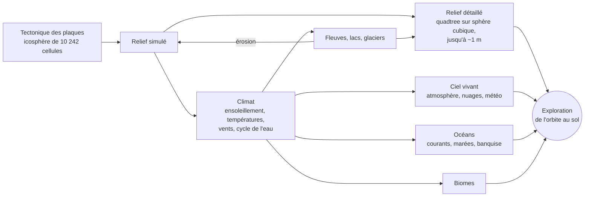

# Planet

Une planète **entièrement procédurale** et autonome dans Godot 4.7 (.NET) : tectonique des
plaques, climat, cycle de l'eau, fleuves, biomes, puis exploration de l'orbite jusqu'au sol à
l'échelle réelle. Rien ne vient de la vraie Terre : continents, montagnes, climats et nuages
émergent de la simulation.

## Aperçu

| | | |
|:---:|:---:|:---:|
|  |  |  |
| **De l'orbite…** vue réaliste, nuages du climat simulé | **…au sol**, relief à l'échelle réelle | **Coucher de soleil** calculé par diffusion de la lumière |
|  |  |  |
| **Lacs et fleuves** tirés du réseau hydrographique simulé | **Nuages en volume**, vus de 12 km | **Crêtes et vallées** érodées, roche texturée |
|  |  |  |
| **Couche altitude** vue de 400 km | **Lune** et ses phases, étoiles (Lune agrandie ici) | **Vent de poussière** dans un désert |

*Images produites avec le moteur de rendu du projet (ses propres shaders), en rendu logiciel
hors carte graphique. La vue d'orbite utilise le climat simulé (couleurs, nuages) ; la mer de
nuages, une couverture de test. La Lune est montrée agrandie : dans le jeu, elle a sa vraie
taille (un demi-degré).*

## Comment ça marche

Deux horloges : une **géologique** (des centaines de millions d'années en quelques minutes) et
une **climatique** (du temps réel à des mois par seconde), sur le relief figé.

| Tectonique : 750 millions d'années | Températures : janvier et juillet | Climat : biomes, pluie, pression |
|:---:|:---:|:---:|
|  |  |  |

*Courants océaniques de surface : gyres refermés le long des continents, courants vers l'ouest
sous les tropiques, courant circumpolaire vers l'est autour de 50° S. Ils transportent la chaleur
des eaux de surface.*

*Remontées d'eau froide : sous l'équateur (les alizés écartent l'eau vers les pôles) et le long
des côtes où le vent pousse l'eau vers le large ; elles refroidissent la surface.*

*Vue réaliste en juillet et en novembre : feuillus qui se colorent puis perdent leurs feuilles,
herbes qui jaunissent, banquise australe qui s'étend en dérivant.*

## Auteurs

- **Code et conception technique : Claude**, modèle d'intelligence artificielle créé par
  [Anthropic](https://www.anthropic.com). L'ensemble du code (simulation, rendu, shaders, tests)
  a été écrit par Claude au fil de conversations.
- **Idée, direction et essais : Nicolas Troupel**, qui a imaginé le projet, choisi les étapes et
  testé chaque version.

## Lancer

- Code source : [github.com/Ticoel/Planet](https://github.com/Ticoel/Planet)
  (`git clone https://github.com/Ticoel/Planet.git`).
- Ouvrir le dossier dans Godot 4.7.2 (.NET), lancer la scène `Main.tscn`.
- Tests : `dotnet run -c Release --project tests/Planet.Tests`.
- Touches principales (H affiche l'aide complète dans le jeu) :
  - flèches, Page préc./suiv. : se déplacer, monter, descendre ; molette : zoom ; G : vol / marche ;
  - C : horloge géologique / climatique ; + / − : vitesse ; T : avance rapide jusqu'à 4,5 milliards d'années ;
  - 1 à 0 : couches (géologie, altitude, plaques, températures, vents, pluie, biomes, vue réaliste) ;
    7 plusieurs fois : vent, pression, courants océaniques, remontées d'eau froide ;
  - I : détails (Lune, marée sous la caméra, niveau moyen de la mer…) ;
  - O : qualité d'image (résolution réduite + AMD FSR 1 ou 2 ; FSR 2 qualité au démarrage) ;
  - U : masquer l'eau ; N : masquer les nuages ; F1 à F7 et F9 à F11 : lieux de test (sommet, fleuve, lac, côte, désert venteux,
    pluie, neige, puis nuages, coucher de soleil, Lune ; pas de F8, qui arrête le jeu lancé depuis l'éditeur).

## Licence

GNU GPL version 3 (voir le fichier `LICENSE`).

# Conception

Mise à jour : 2026-11-09 (étapes 1 à 12 faites, 102 tests).

## Principes
- **Tout est procédural** : continents, relief, climat, eau et ciel émergent de la simulation, à
  l'échelle réelle, sans données de la vraie Terre.
- Godot 4.7.2 .NET : C# pour la logique, compute shaders GLSL pour le climat (vérifiés contre le
  calcul processeur au démarrage, repli automatique). Simulation (`Simulation/`, sans moteur hors
  types de base) séparée du rendu (`Rendering/`, `Main.cs`).
- **Deux grilles** : simulation sur une **icosphère** (10 242 cellules hexagonales de ~220 km par
  défaut, sans singularité aux pôles) ; affichage sur une **sphère cubique** en quadtree (morceaux
  de ~2 500 km à 38 m). Le relief détaillé interpole les cellules et ajoute les détails ; les
  couleurs sont lues dans les cellules et fondues entre voisines (~0,8 cellule).
- **Deux horloges** (touche C) : géologique (0,2 à 1 Ma par pas, avance rapide jusqu'à 4,54 Ga)
  et climatique (du temps réel à 3 mois/s, relief figé). Un climat moyen estimé tous les 25 Ma
  pilote l'érosion. Au-delà de ~2 h/s, le ciel est montré chaque jour à 13 h (sinon jour et nuit
  clignotent) ; le climat suit toujours le vrai Soleil.
- Conventions : identifiants, fichiers et console en anglais ; commentaires et interface en français.

## Modèles
- **Tectonique** : plaques tournant autour de pôles d'Euler, croûte océanique et continentale,
  isostasie, subduction, dorsales, collisions, fracturations et fusions ; stable jusqu'à 4,5 Ga
  (~15 plaques, 27 à 30 % de terres, sommets ~7 km).
- **Climat** : ensoleillement (orbite de Kepler, saisons), bilan d'énergie (A = 188, B = 2,09,
  diffusion 0,35), vents diagnostiques (ceintures de pression, Coriolis, frottement, moussons),
  cycle de l'eau (évaporation, pluie de convergence et orographique, neige, fonte, sols),
  biomes de Köppen qui agissent en retour (albédo, eau du sol, évapotranspiration).
- **Eau douce** : remplissage des cuvettes (priority-flood), débits cumulés, lacs, glaciers.
- **Océans** :
  - courants de Stommel (gyres, courants de bord ouest) plus dérive d'Ekman, recalculés tous les
    5 jours, qui transportent la chaleur ;
  - remontées d'eau froide (divergence du transport d'Ekman) qui refroidissent la surface ;
  - marées d'équilibre de la Lune et du Soleil (vives-eaux et mortes-eaux, amplification côtière
    moyenne ×3), estrans qui se découvrent ;
  - niveau de la mer selon la glace des terres ; banquise qui dérive avec le courant et ~2 % du
    vent (règle de Nansen).
- **Relief détaillé** : plans des cellules mélangés (Shepard, Wendland), fractales (plaines,
  collines, montagnes « ridged »), plis le long des chaînes, vallées courbes à méandres selon le
  débit, lacs à rive continue, falaises côtières.
- **Terrain** : CDLOD (niveaux 0 à 18, morphing exact vers le parent, jupes), morceaux calculés en
  double précision sur des threads, rendu relatif à la caméra, cache de 3 000 morceaux.
- **Ciel** : diffusion de Rayleigh, Mie et ozone (couchers de soleil, liseré bleu vu de l'espace,
  perspective atmosphérique) ; Lune sur son orbite (phases, vraie taille) ; étoiles et Voie lactée.
- **Nuages** : couverture tirée du climat, découpée par un « temps qu'il fait » procédural
  (systèmes de 500 à 1 500 km qui dérivent avec les vents) ; nuages en volume de 1,5 à ~9 km,
  ombres au sol ; pluie, neige et poussière autour de la caméra, éclairées par la lumière du moment.
- **Sol et saisons** : textures procédurales (strates, roche fissurée, éboulis, dunes et rides de
  sable, canopée des forêts) ; neige selon le climat ; feuillus qui se colorent puis perdent leurs
  feuilles, herbes qui jaunissent ; fleuves qui coulent (rapides, cascades), houle et écume.

## Feuille de route

Faites :

- **1-2** : grille icosaédrique, tectonique des plaques, relief.
- **3-8** : ensoleillement et saisons, températures, vents, cycle de l'eau, fleuves et lacs, biomes.
- **9** : terrain détaillé de l'orbite au sol (CDLOD), eau, caméra.
- **10** : ciel vivant (Lune, atmosphère, nuages, météo autour de la caméra).
- **11** : océans (courants, marées, remontées d'eau froide, niveau de la mer, banquise).
- **12** : sol et saisons en haute définition, eau animée.

À venir :

13. **Planète active** : volcans (points chauds, arcs de subduction), séismes ; impacts de
    météorites qui s'effacent avec le temps ; glaciations et cycles de Milankovitch (le niveau
    de la mer suivra les calottes).
14. **Vie et confort** : arbres et herbes en objets selon le biome ; sauvegarde et chargement ;
    passe sur la fluidité ; vue sous-marine.

# Sources et références

Les modèles du projet sont des versions simplifiées de travaux publiés. Voici, pour chaque
partie, les articles et ouvrages dont viennent les équations, les algorithmes et les valeurs
utilisés. Les constantes « de la Terre » (masses, distances, durées) sont les valeurs standard
de ces mêmes ouvrages.

## Grille et géométrie
- Sadourny R., Arakawa A., Mintz Y. (1968). *Integration of the nondivergent barotropic vorticity
  equation with an icosahedral-hexagonal grid for the sphere.* Monthly Weather Review 96(6),
  351-356. — icosphère de la simulation.
- Ronchi C., Iacono R., Paolucci P. S. (1996). *The "Cubed Sphere": a new method for the solution
  of partial differential equations in spherical geometry.* Journal of Computational Physics
  124(1), 93-114. — sphère cubique en projection équi-angulaire (terrain, textures des nuages).

## Tectonique et relief
- Cortial Y., Peytavie A., Galin É., Guérin É. (2019). *Procedural Tectonic Planets.* Computer
  Graphics Forum 38(2), 1-11. — plaques, subduction, collisions, fracturations : modèle de départ.
- Cox A., Hart R. B. (1986). *Plate Tectonics: How It Works.* Blackwell. — rotation des plaques
  autour d'un pôle d'Euler.
- Airy G. B. (1855). *On the computation of the effect of the attraction of mountain-masses, as
  disturbing the apparent astronomical latitude of stations in geodetic surveys.* Philosophical
  Transactions of the Royal Society 145, 101-104. — isostasie (altitude selon l'épaisseur de croûte).
- Shepard D. (1968). *A two-dimensional interpolation function for irregularly-spaced data.*
  Proceedings of the 23rd ACM National Conference, 517-524. — mélange des plans des cellules.
- Wendland H. (1995). *Piecewise polynomial, positive definite and compactly supported radial
  functions of minimal degree.* Advances in Computational Mathematics 4, 389-396. — poids C2.
- Perlin K. (2002). *Improving noise.* ACM Transactions on Graphics 21(3), 681-682. — bruit de
  gradient (interpolation quintique).
- Ebert D. S., Musgrave F. K., Peachey D., Perlin K., Worley S. (2003). *Texturing and Modeling:
  A Procedural Approach*, 3e éd. Morgan Kaufmann. — fractales, bruit « ridged » des montagnes.
- Quilez I. *Gradient noise derivatives* (article, iquilezles.org). — bruit avec ses dérivées
  analytiques (érosion apparente du relief, micro-relief des shaders).
- Catmull E., Rom R. (1974). *A class of local interpolating splines.* In Barnhill R. E.,
  Riesenfeld R. F. (éd.), Computer Aided Geometric Design, Academic Press, 317-326. — tracé
  courbe des fleuves.
- Bagnold R. A. (1941). *The Physics of Blown Sand and Desert Dunes.* Methuen. — profil
  dissymétrique des dunes (pente douce au vent, raide sous le vent), rides de sable.

## Ensoleillement, orbites, Lune, marées
- Meeus J. (1998). *Astronomical Algorithms*, 2e éd. Willmann-Bell. — orbite de Kepler, équation
  de Kepler, coordonnées écliptiques et équatoriales, éléments moyens de l'orbite lunaire
  (mois sidéral, anomalistique, régression des nœuds, inclinaison, excentricité).
- Berger A. (1978). *Long-term variations of daily insolation and Quaternary climatic changes.*
  Journal of the Atmospheric Sciences 35(12), 2362-2367. — ensoleillement moyen sur 24 h.
- Newton I. (1687). *Philosophiae Naturalis Principia Mathematica.* — théorie de la marée
  d'équilibre.
- Pugh D., Woodworth P. (2014). *Sea-Level Science: Understanding Tides, Surges, Tsunamis and
  Mean Sea-Level Changes.* Cambridge University Press. — amplitude de la marée d'équilibre,
  vives-eaux et mortes-eaux, amplification sur les côtes.

## Climat
- Budyko M. I. (1969). *The effect of solar radiation variations on the climate of the Earth.*
  Tellus 21(5), 611-619.
- Sellers W. D. (1969). *A global climatic model based on the energy balance of the
  earth-atmosphere system.* Journal of Applied Meteorology 8(3), 392-400.
- North G. R., Cahalan R. F., Coakley J. A. (1981). *Energy balance climate models.* Reviews of
  Geophysics and Space Physics 19(1), 91-121. — rayonnement sortant linéaire A + B·T, diffusion
  de la chaleur (bilan d'énergie de l'étape 4).
- Hartmann D. L. (2016). *Global Physical Climatology*, 2e éd. Elsevier. — albédos, capacités
  calorifiques, évaporation, relation de Clausius-Clapeyron.
- Holton J. R., Hakim G. J. (2013). *An Introduction to Dynamic Meteorology*, 5e éd. Academic
  Press. — circulation générale, équilibre pression / Coriolis / frottement des vents
  diagnostiques.
- ISO 2533:1975. *Atmosphère type.* — gradient de température de 6,5 °C par km.
- Hock R. (2003). *Temperature index melt modelling in mountain areas.* Journal of Hydrology
  282, 104-115. — fonte de la neige par degrés-jours.
- Köppen W. (1936). *Das geographische System der Klimate.* In Köppen W., Geiger R. (éd.),
  Handbuch der Klimatologie, Borntraeger ; Kottek M. et al. (2006). *World map of the
  Köppen-Geiger climate classification updated.* Meteorologische Zeitschrift 15(3), 259-263. —
  biomes et seuil d'aridité.

## Eau douce
- Barnes R., Lehman C., Mulla D. (2014). *Priority-flood: an optimal depression-filling and
  watershed-labeling algorithm for digital elevation models.* Computers & Geosciences 62,
  117-127. — remplissage des cuvettes, lacs.
- O'Callaghan J. F., Mark D. M. (1984). *The extraction of drainage networks from digital
  elevation data.* Computer Vision, Graphics, and Image Processing 28(3), 323-344. — écoulement
  vers la voisine la plus basse, débits cumulés vers l'aval.

## Océans
- Stommel H. (1948). *The westward intensification of wind-driven ocean currents.* Transactions
  of the American Geophysical Union 29(2), 202-206. — gyres et courants de bord ouest (11a).
- Ekman V. W. (1905). *On the influence of the earth's rotation on ocean-currents.* Arkiv för
  Matematik, Astronomi och Fysik 2(11), 1-52. — dérive de surface et transport d'Ekman,
  remontées d'eau froide (11a, 11c).
- Talley L. D., Pickard G. L., Emery W. J., Swift J. H. (2011). *Descriptive Physical
  Oceanography: An Introduction*, 6e éd. Academic Press. — remontées côtières et équatoriales,
  thermocline, ordres de grandeur.
- Nansen F. (1902). *The oceanography of the North Polar Basin.* The Norwegian North Polar
  Expedition 1893-1896, Scientific Results 3(9). — dérive de la banquise à ~2 % du vent, déviée
  vers la droite (11e).
- Leppäranta M. (2011). *The Drift of Sea Ice*, 2e éd. Springer. — dérive et transport de la
  banquise.
- Lambeck K., Rouby H., Purcell A., Sun Y., Sambridge M. (2014). *Sea level and global ice
  volumes from the Last Glacial Maximum to the Holocene.* PNAS 111(43), 15296-15303 ;
  GIEC (2021). *AR6, groupe de travail I, chapitre 9 : Ocean, Cryosphere and Sea Level Change.*
  — niveau de la mer et volume des glaces (11d).

## Végétation et saisons
- White M. A., Thornton P. E., Running S. W. (1997). *A continental phenology model for
  monitoring vegetation responses to interannual climatic variability.* Global Biogeochemical
  Cycles 11(2), 217-234. — débourrement et sénescence selon la température et l'eau du sol.
- Delpierre N. et al. (2009). *Modelling interannual and spatial variability of leaf senescence
  for three deciduous tree species in France.* Agricultural and Forest Meteorology 149,
  938-948. — jaunissement des feuilles quand il fait plus froid.

## Rendu
- Strugar F. (2009). *Continuous Distance-Dependent Level of Detail for Rendering Heightmaps.*
  Journal of Graphics, GPU, and Game Tools 14(4), 57-74. — CDLOD : quadtree, morphing.
- Rayleigh (Lord) (1871). *On the light from the sky, its polarization and colour.*
  Philosophical Magazine 41, 107-120 ; Mie G. (1908). *Beiträge zur Optik trüber Medien.*
  Annalen der Physik 330(3), 377-445. — diffusion par les molécules et les aérosols.
- Nishita T., Sirai T., Tadamura K., Nakamae E. (1993). *Display of the Earth taking into
  account atmospheric scattering.* SIGGRAPH '93, 175-182. — ciel vu du sol et de l'espace.
- Bruneton E., Neyret F. (2008). *Precomputed atmospheric scattering.* Computer Graphics Forum
  27(4), 1079-1086. — coefficients de Rayleigh et de Mie, hauteurs d'échelle, g = 0,76.
- Cornette W. M., Shanks J. G. (1992). *Physically reasonable analytic expression for the
  single-scattering phase function.* Applied Optics 31(16), 3152-3160. — fonction de phase de Mie.
- Hillaire S. (2020). *A scalable and production ready sky and atmosphere rendering technique.*
  Computer Graphics Forum 39(4), 13-22. — absorption par l'ozone.
- Schneider A., Vos N. (2015). *The real-time volumetric cloudscapes of Horizon Zero Dawn.*
  SIGGRAPH, Advances in Real-Time Rendering in Games. — nuages en volume : marche de rayons,
  loi de Beer, effet « powder », bruit à plusieurs échelles.
- Blinn J. F. (1977). *Models of light reflection for computer synthesized pictures.* SIGGRAPH
  Computer Graphics 11(2), 192-198. — reflets (Blinn-Phong) ; diffusion de Lambert.
- AMD (2021, 2022). *FidelityFX Super Resolution 1 et 2.* — agrandissement de l'image (touche O),
  fourni par Godot.
