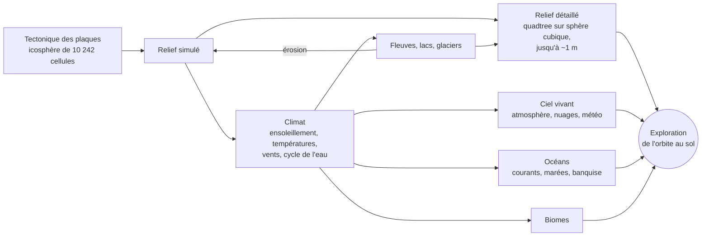
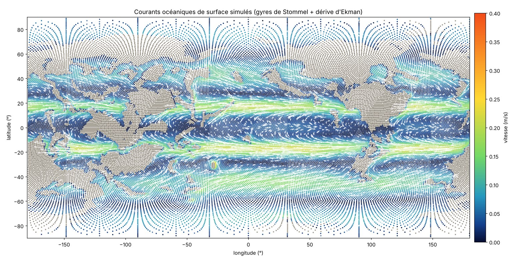
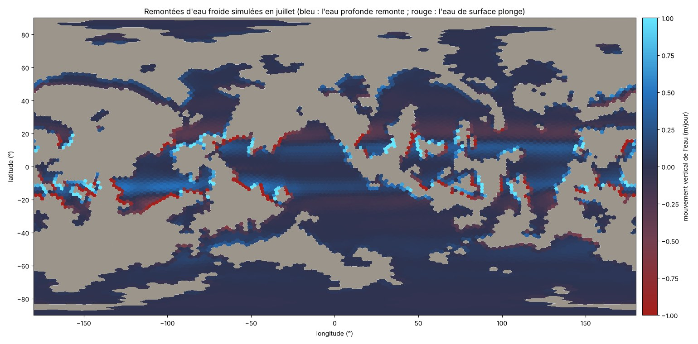
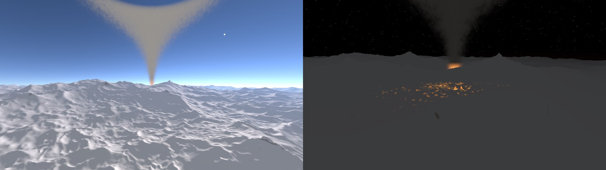
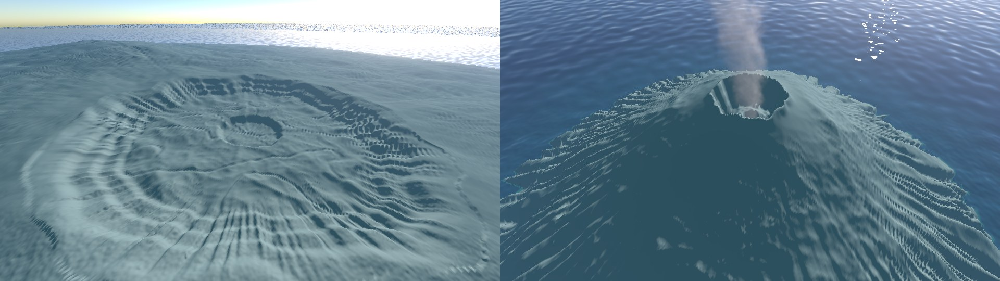
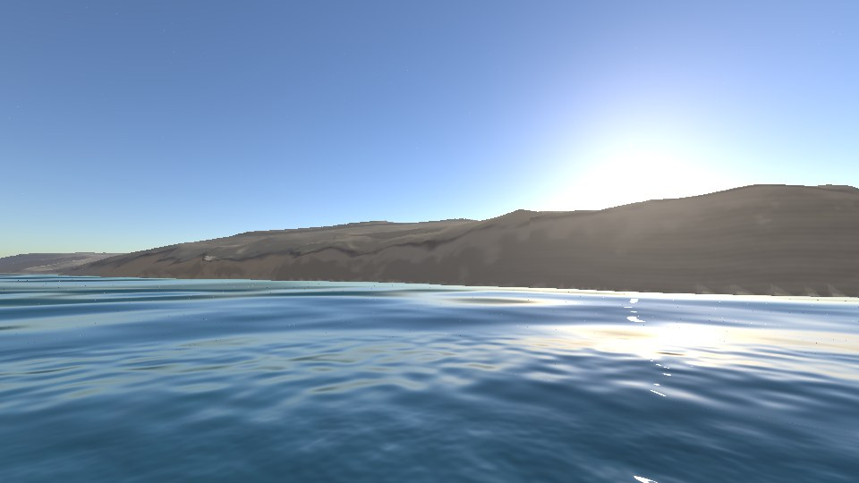
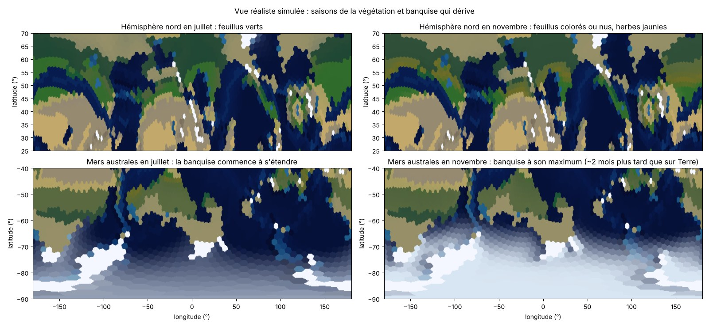

# Planet

Une planète **entièrement procédurale** et autonome dans Godot 4.7 (.NET) : tectonique des
plaques, climat, cycle de l'eau, fleuves, biomes, puis exploration de l'orbite jusqu'au sol à
l'échelle réelle. Rien ne vient de la vraie Terre : continents, montagnes, climats et nuages
émergent de la simulation.

## Aperçu

| | | |
|:---:|:---:|:---:|
|  |  |  |
| **De l'orbite…** vue réaliste, nuages du climat simulé | **…au sol**, relief à l'échelle réelle | **Coucher de soleil** calculé par diffusion de la lumière |
|  |  |  |
| **Lacs et fleuves** tirés du réseau hydrographique simulé | **Nuages en volume**, vus de 12 km | **Crêtes et vallées** érodées, roche texturée |
|  |  |  |
| **Couche altitude** vue de 400 km | **Lune** et ses phases, étoiles (Lune agrandie ici) | **Vent de poussière** dans un désert |

*Images produites avec le moteur de rendu du projet (ses propres shaders), en rendu logiciel
hors carte graphique. La vue d'orbite utilise le climat simulé (couleurs, nuages) ; la mer de
nuages, une couverture de test. La Lune est montrée agrandie : dans le jeu, elle a sa vraie
taille (un demi-degré).*

## Comment ça marche

Deux horloges : une **géologique** (des centaines de millions d'années en quelques minutes) et
une **climatique** (du temps réel à des mois par seconde), sur le relief figé.

| Tectonique : 750 millions d'années | Températures : janvier et juillet | Climat : biomes, pluie, pression |
|:---:|:---:|:---:|
|  |  |  |

*Courants océaniques de surface : gyres refermés le long des continents, courants vers l'ouest
sous les tropiques, courant circumpolaire vers l'est autour de 50° S. Ils transportent la chaleur
des eaux de surface.*

*Remontées d'eau froide : sous l'équateur (les alizés écartent l'eau vers les pôles) et le long
des côtes où le vent pousse l'eau vers le large ; elles refroidissent la surface.*

*Éruption : panache calculé en volume, colonne qui bouillonne au-dessus d'un nuage de cendres
roulant sur le sommet, puis ombrelle que le vent étire en une longue traînée (à gauche) ; vue
d'avion, la traînée et son ombre sur le relief (au milieu) ; la nuit, coulée de lave simulée
comme un fluide, qui descend du cratère en suivant le relief (à droite). Rendu du
moteur du projet ; les éruptions sont placées ici pour l'image, dans le jeu elles naissent sur
les volcans simulés.*

*Sommets des volcans : caldeira d'un bouclier, au contour festonné, aux parois en gradins
ravinées, au fond fissuré et au puits central (à gauche) ; cratère d'un stratovolcan, aux flancs
creusés de ravines rayonnantes (à droite).*

*Falaise côtière trouvée par la vue Maj + F4 : la plus haute paroi raide de la côte, vue du large
à hauteur de vagues.*

*Vue réaliste en juillet et en novembre : feuillus qui se colorent puis perdent leurs feuilles,
herbes qui jaunissent, banquise australe qui s'étend en dérivant.*

## Auteurs

- **Code et conception technique : Claude**, modèle d'intelligence artificielle créé par
  [Anthropic](https://www.anthropic.com). L'ensemble du code (simulation, rendu, shaders, tests)
  a été écrit par Claude au fil de conversations.
- **Idée, direction et essais : Nicolas Troupel**, qui a imaginé le projet, choisi les étapes et
  testé chaque version.

## Lancer

- Code source : [github.com/Ticoel/Planet](https://github.com/Ticoel/Planet)
  (`git clone https://github.com/Ticoel/Planet.git`).
- Ouvrir le dossier dans Godot 4.7.2 (.NET), lancer la scène `Main.tscn`.
- Tests : `dotnet run -c Release --project tests/Planet.Tests`.
- **Interface** (Tab pour la masquer) : le jeu est une boîte de Petri à l'échelle d'une planète ;
  on règle les paramètres, on laisse tourner, on observe.
  - barre du haut : pause, vitesse, horloge, date, qualité graphique ;
  - à gauche, les **couches** (ce qu'on regarde) ; à droite, les **paramètres** (ce qu'on règle :
    masse de l'étoile, lumière reçue, inclinaison de l'axe, excentricité, effet de serre,
    fréquence des éruptions), avec un repère de la valeur terrestre et un bouton pour y revenir ;
    un réglage s'applique à la planète en cours, sans la recréer ;
  - en bas : la **sonde** (clic sur la planète : fiche du lieu), les **courbes** (température,
    lumière de l'étoile, terres émergées, glaces, niveau de la mer…) et le **journal** des
    événements ;
  - l'interface est modulaire : chaque paramètre, couche, ligne de sonde ou courbe est inscrit
    une seule fois dans un registre (`Ui/UiRegistry.cs`, inscriptions dans `Main.Ui.cs`) et les
    panneaux se construisent seuls.
- Touches principales (H affiche l'aide complète dans le jeu) :
  - flèches, Page préc./suiv. : se déplacer, monter, descendre ; molette : avancer / reculer dans l'axe du regard ; G : vol / marche ;
  - C : horloge géologique / climatique ; + / − : vitesse ; T : avance rapide jusqu'à 4,5 milliards d'années ;
  - 1 à 0 : couches (géologie, altitude, plaques, températures, vents, pluie, biomes, vue réaliste) ;
    7 plusieurs fois : vent, pression, courants océaniques, remontées d'eau froide ;
  - I : détails (Lune, marée sous la caméra, niveau moyen de la mer…) ;
  - O : qualité graphique, trois niveaux (haute au démarrage) :
    - **basse** : image calculée à 59 % puis agrandie (AMD FSR 1), relief allégé, pas d'ombres
      portées, lancer de rayons grossier dans les nuages et les panaches ;
    - **moyenne** : image à 67 % (FSR 2), ombres portées du relief ;
    - **haute** : pleine résolution lissée par FSR 2, relief plus fin au loin, ombres douces en
      haute définition, nuages et panaches plus fins ;
  - U : masquer l'eau ; N : masquer les nuages ; K : couper le son ;
  - E : étoile suivante (masse, donc durée de vie ; une nouvelle planète se forme autour) ;
  - F12 : photo ; Maj + F12 : vidéo (marche / arrêt) ; M : carte de la couche affichée à cet instant
    (fichiers rangés dans le dossier Images/Planet) ;
  - F1 à F7 et F9 à F11 : lieux de test (sommet, fleuve, lac, côte, désert venteux, pluie, neige, puis
    nuages, coucher de soleil, Lune ; pas de F8, qui arrête le jeu lancé depuis l'éditeur) ;
    Maj + F4 : la plus haute falaise de la côte, vue du large ; L : volcan.

## Licence

GNU GPL version 3 (voir le fichier `LICENSE`).

# Conception

Mise à jour : 2026-11-09 (étapes 1 à 13 faites, 118 tests).

## Principes
- **Tout est procédural** : continents, relief, climat, eau et ciel émergent de la simulation, à
  l'échelle réelle, sans données de la vraie Terre.
- Godot 4.7.2 .NET : C# pour la logique, compute shaders GLSL pour le climat (vérifiés contre le
  calcul processeur au démarrage, repli automatique). Simulation (`Simulation/`, sans moteur hors
  types de base) séparée du rendu (`Rendering/`, `Main.cs`).
- **Deux grilles** : simulation sur une **icosphère** (10 242 cellules hexagonales de ~220 km par
  défaut, sans singularité aux pôles) ; affichage sur une **sphère cubique** en quadtree (morceaux
  de ~2 500 km à 38 m). Le relief détaillé interpole les cellules et ajoute les détails ; les
  couleurs sont lues dans les cellules et fondues entre voisines (~0,8 cellule).
- **Deux horloges** (touche C) : géologique (0,2 à 1 Ma par pas, avance rapide jusqu'à 4,54 Ga)
  et climatique (du temps réel à 3 mois/s, relief figé). Un climat moyen estimé tous les 25 Ma
  pilote l'érosion. Au-delà de ~2 h/s, le ciel est montré chaque jour à 13 h (sinon jour et nuit
  clignotent) ; le climat suit toujours le vrai Soleil.
- Conventions : identifiants, fichiers et console en anglais ; commentaires et interface en français.

## Modèles
- **Tectonique** : plaques tournant autour de pôles d'Euler, croûte océanique et continentale,
  isostasie, subduction, dorsales, collisions, fracturations et fusions ; stable jusqu'à 4,5 Ga
  (~15 plaques, 27 à 30 % de terres, sommets ~7 km).
- **Climat** : ensoleillement (orbite de Kepler, saisons), bilan d'énergie (A = 188, B = 2,09,
  diffusion 0,35), vents diagnostiques (ceintures de pression, Coriolis, frottement, moussons),
  cycle de l'eau (évaporation, pluie de convergence et orographique, neige, fonte, sols),
  biomes de Köppen qui agissent en retour (albédo, eau du sol, évapotranspiration).
- **Eau douce** : remplissage des cuvettes (priority-flood), débits cumulés, lacs, glaciers.
- **Océans** :
  - courants de Stommel (gyres, courants de bord ouest) plus dérive d'Ekman, recalculés tous les
    5 jours, qui transportent la chaleur ;
  - remontées d'eau froide (divergence du transport d'Ekman) qui refroidissent la surface ;
  - marées d'équilibre de la Lune et du Soleil (vives-eaux et mortes-eaux, amplification côtière
    moyenne ×3), estrans qui se découvrent ;
  - niveau de la mer selon la glace des terres ; banquise qui dérive avec le courant et ~2 % du
    vent (règle de Nansen).
- **Relief détaillé** : plans des cellules mélangés (Shepard, Wendland), fractales (plaines,
  collines, montagnes « ridged »), plis le long des chaînes, vallées courbes à méandres selon le
  débit, lacs à rive continue, falaises côtières.
- **Terrain** : CDLOD (niveaux 0 à 18, morphing exact vers le parent, jupes), morceaux calculés en
  double précision sur des threads, rendu relatif à la caméra, cache de 3 000 morceaux.
- **Ciel** : diffusion de Rayleigh, Mie et ozone (couchers de soleil, liseré bleu vu de l'espace,
  perspective atmosphérique) ; Lune sur son orbite (phases, vraie taille) ; étoiles et Voie lactée.
- **Nuages** : couverture tirée du climat, découpée par un « temps qu'il fait » procédural
  (systèmes de 500 à 1 500 km qui dérivent avec les vents) ; nuages en volume de 1,5 à ~9 km,
  ombres au sol ; pluie, neige et poussière autour de la caméra, éclairées par la lumière du moment.
- **Ombres portées du relief** (qualité moyenne et haute) : quatre cartes d'ombre en cascade,
  dont la portée suit l'altitude (fines au sol, larges vues d'avion, estompées depuis l'orbite) ;
  les montagnes hors du champ de vision projettent aussi leur ombre dans le champ.
- **Sol et saisons** : textures procédurales (strates, roche fissurée, éboulis, dunes et rides de
  sable, canopée des forêts) ; neige selon le climat ; feuillus qui se colorent puis perdent leurs
  feuilles, herbes qui jaunissent ; fleuves qui coulent (rapides, cascades), houle et écume ;
  côtes à falaises sur ~60 % des rivages ; eau plus sombre et saturée que le sol.
- **Planète active** :
  - points chauds fixes sous les plaques : chaînes d'îles volcaniques de plus en plus vieilles,
    érodées puis englouties ; volcans d'arc au-dessus des subductions ;
  - cratères d'impact (taux actuel ~1,8 cratère de plus de 20 km par Ma, loi de taille en D^−1,8,
    bombardement intense des débuts selon la chronologie lunaire), effacés par l'érosion ;
  - volcans et cratères sculptés dans le relief détaillé (cônes, caldeiras, cuvettes, remparts,
    pitons centraux) ;
  - proportions des volcans d'après les volcans terrestres : boucliers de 25 à 120 km de large,
    hauts de ~7 % de leur rayon (de Skjaldbreiður au Mauna Loa), caldeira de ~5 % du diamètre ;
    stratovolcans à cratère de quelques centaines de mètres ; panaches et fumerolles à la mesure
    de l'édifice (plus hauts et plus larges sur un grand volcan) ;
  - détails des volcans, propres à chacun : zones de rift (crêtes rayonnantes et fissures des
    boucliers), cônes de scories avec leur cratère, coulées allongées dans la pente, relief des
    champs de lave, ravines rayonnantes (dès la naissance d'un strato, avec l'âge pour un
    bouclier) ; caldeira festonnée à parois en gradins ravinées, éboulis, fond fissuré et puits
    central ;
  - volcans repérables de loin : flancs sombres de lave et de cendres, panache de vapeur des
    volcans actifs (touche L : vue de côté sur un volcan, en éruption s'il y en a une) ;
  - coulées de lave simulées comme un fluide autour de l'éruption la plus proche (automate
    cellulaire de 256 × 256 cellules de 40 m) : la lave descend la pente, suit les vallées,
    remplit les creux, ne coule que plus épaisse qu'une épaisseur critique (fluide de Bingham),
    refroidit par sa surface et se fige en basalte noir ; volcans sous-marins : rien en surface
    sous 200 m d'eau, panache de vapeur au-dessus (type Surtsey) ;
  - panaches d'éruption en volume (lancer de rayons adaptatif dans une densité bruitée) : colonne
    qui bouillonne en volutes, penchée par le vent simulé à la bouche, ombrelle à sa hauteur
    d'équilibre que le vent étire en une traînée persistante (plus longue si le vent est fort),
    qui s'élargit et s'éclaircit en s'éloignant ; nuage de cendres au pied des colonnes
    explosives ; ombre propre et ombre portée sur le relief ; fumerolles de vapeur couchées par
    le vent ; lueur de la lave à la base et éclairs la nuit (horloge climatique seulement) ;
  - dans l'horloge climatique : une vingtaine d'éruptions en même temps sur la planète, comme sur
    Terre (lave incandescente, panaches de cendres, voile d'aérosols qui refroidit la planète après
    les plus fortes) et séismes aux frontières de plaques
    (loi de Gutenberg-Richter, secousse de la caméra quand ils sont ressentis) ;
  - glaciations : cycles de Milankovitch (excentricité, inclinaison, précession), volume des glaces
    (Imbrie), mer jusqu'à ~130 m plus bas et limite des neiges abaissée sur une planète assez froide ;
    le climat simulé reçoit l'orbite du moment.
- **L'étoile** : système à une étoile, une planète et une lune. La masse de l'étoile (touche E,
  0,8 à 1,4 masse solaire) fixe sa durée de vie (~10 milliards d'années × M^−2,5), sa luminosité,
  la distance de la planète (même lumière que la Terre à mi-vie) et la durée de l'année (Kepler).
  L'étoile s'éclaire en vieillissant (jeune Soleil ~30 % plus faible) ; le gaz carbonique compense
  une étoile faible mais pas une étoile trop forte : la planète finit par chauffer. En géante rouge,
  l'étoile enfle et rougit dans le ciel ; **quand elle meurt, la partie est finie** (R : nouvelle
  planète, E : autre étoile).
- **Sons** : vent, pluie, vagues, tonnerre, grondements des volcans et des séismes, entièrement
  synthétisés et pilotés par la simulation (extrait : `docs/sons.mp3`).
- **Captures** : photos sans l'interface, vidéos AVI Motion JPEG à 30 images/s encodées en tâche de
  fond, cartes équirectangulaires de n'importe quelle couche à l'instant t.

## Feuille de route

Faites :

- **1-2** : grille icosaédrique, tectonique des plaques, relief.
- **3-8** : ensoleillement et saisons, températures, vents, cycle de l'eau, fleuves et lacs, biomes.
- **9** : terrain détaillé de l'orbite au sol (CDLOD), eau, caméra.
- **10** : ciel vivant (Lune, atmosphère, nuages, météo autour de la caméra).
- **11** : océans (courants, marées, remontées d'eau froide, niveau de la mer, banquise).
- **12** : sol et saisons en haute définition, eau animée.
- **13** : planète active (volcans, séismes, impacts, glaciations), sons, photos, vidéos et cartes.

À venir :

- **Milieux volcaniques** : geysers, sources et mares chaudes, fumerolles, sources
  hydrothermales sous-marines autour des volcans actifs (berceaux possibles de la vie).
- **Chimie** : éléments répartis sur la planète (carbone, azote, phosphore, soufre, fer, eau…),
  nourris par les roches, le volcanisme, l'érosion et les fleuves ; lisibles à la sonde.

14. **Vie** : apparition et évolution d'espèces simples qui se répartissent selon le climat et
    s'adaptent ; leur action sur le milieu (voir plus bas).
15. **Confort** : sauvegarde et chargement d'une planète ; vue sous-marine ; arbres et herbes en
    objets au sol.

### Pistes pour la vie et son action sur le milieu

- **Populations par cellule** plutôt qu'individus : densité de chaque espèce (ou groupe
  fonctionnel : plantes pionnières, forêts, herbivores, prédateurs) dans chaque cellule, croissance
  selon le climat, dispersion vers les voisines, compétition et prédation (équations de
  Lotka-Volterra). Évolution : traits qui varient (tolérance au froid, à la sécheresse, taille) et
  sélection par le milieu ; spéciation quand des populations restent isolées (îles, chaînes de
  montagnes).
- **Action sur le milieu**, en retour : la végétation change l'albédo, retient l'eau et l'humus
  (moins d'érosion), produit l'oxygène et capte le carbone (effet de serre, donc climat) ; les
  coraux construisent des récifs ; les castors ou les termites modifient localement le terrain.
- **Modifier le terrain** : le relief détaillé est une fonction calculée à la demande, donc
  facile à compléter par des **calques de modifications** (creuser, bâtir, déposer) stockés par
  morceau du quadtree. Les voxels ne seraient utiles que pour des grottes ou des surplombs : on
  pourrait les limiter à de petites zones (quelques centaines de mètres) autour des lieux modifiés.

# Sources et références

Les modèles du projet sont des versions simplifiées de travaux publiés. Voici, pour chaque
partie, les articles et ouvrages dont viennent les équations, les algorithmes et les valeurs
utilisés. Les constantes « de la Terre » (masses, distances, durées) sont les valeurs standard
de ces mêmes ouvrages.

## Grille et géométrie
- Sadourny R., Arakawa A., Mintz Y. (1968). *Integration of the nondivergent barotropic vorticity
  equation with an icosahedral-hexagonal grid for the sphere.* Monthly Weather Review 96(6),
  351-356. — icosphère de la simulation.
- Ronchi C., Iacono R., Paolucci P. S. (1996). *The "Cubed Sphere": a new method for the solution
  of partial differential equations in spherical geometry.* Journal of Computational Physics
  124(1), 93-114. — sphère cubique en projection équi-angulaire (terrain, textures des nuages).

## Tectonique et relief
- Cortial Y., Peytavie A., Galin É., Guérin É. (2019). *Procedural Tectonic Planets.* Computer
  Graphics Forum 38(2), 1-11. — plaques, subduction, collisions, fracturations : modèle de départ.
- Cox A., Hart R. B. (1986). *Plate Tectonics: How It Works.* Blackwell. — rotation des plaques
  autour d'un pôle d'Euler.
- Airy G. B. (1855). *On the computation of the effect of the attraction of mountain-masses, as
  disturbing the apparent astronomical latitude of stations in geodetic surveys.* Philosophical
  Transactions of the Royal Society 145, 101-104. — isostasie (altitude selon l'épaisseur de croûte).
- Shepard D. (1968). *A two-dimensional interpolation function for irregularly-spaced data.*
  Proceedings of the 23rd ACM National Conference, 517-524. — mélange des plans des cellules.
- Wendland H. (1995). *Piecewise polynomial, positive definite and compactly supported radial
  functions of minimal degree.* Advances in Computational Mathematics 4, 389-396. — poids C2.
- Perlin K. (2002). *Improving noise.* ACM Transactions on Graphics 21(3), 681-682. — bruit de
  gradient (interpolation quintique).
- Ebert D. S., Musgrave F. K., Peachey D., Perlin K., Worley S. (2003). *Texturing and Modeling:
  A Procedural Approach*, 3e éd. Morgan Kaufmann. — fractales, bruit « ridged » des montagnes.
- Quilez I. *Gradient noise derivatives* (article, iquilezles.org). — bruit avec ses dérivées
  analytiques (érosion apparente du relief, micro-relief des shaders).
- Catmull E., Rom R. (1974). *A class of local interpolating splines.* In Barnhill R. E.,
  Riesenfeld R. F. (éd.), Computer Aided Geometric Design, Academic Press, 317-326. — tracé
  courbe des fleuves.
- Bagnold R. A. (1941). *The Physics of Blown Sand and Desert Dunes.* Methuen. — profil
  dissymétrique des dunes (pente douce au vent, raide sous le vent), rides de sable.

## Ensoleillement, orbites, Lune, marées
- Meeus J. (1998). *Astronomical Algorithms*, 2e éd. Willmann-Bell. — orbite de Kepler, équation
  de Kepler, coordonnées écliptiques et équatoriales, éléments moyens de l'orbite lunaire
  (mois sidéral, anomalistique, régression des nœuds, inclinaison, excentricité).
- Berger A. (1978). *Long-term variations of daily insolation and Quaternary climatic changes.*
  Journal of the Atmospheric Sciences 35(12), 2362-2367. — ensoleillement moyen sur 24 h.
- Newton I. (1687). *Philosophiae Naturalis Principia Mathematica.* — théorie de la marée
  d'équilibre.
- Pugh D., Woodworth P. (2014). *Sea-Level Science: Understanding Tides, Surges, Tsunamis and
  Mean Sea-Level Changes.* Cambridge University Press. — amplitude de la marée d'équilibre,
  vives-eaux et mortes-eaux, amplification sur les côtes.

## Climat
- Budyko M. I. (1969). *The effect of solar radiation variations on the climate of the Earth.*
  Tellus 21(5), 611-619.
- Sellers W. D. (1969). *A global climatic model based on the energy balance of the
  earth-atmosphere system.* Journal of Applied Meteorology 8(3), 392-400.
- North G. R., Cahalan R. F., Coakley J. A. (1981). *Energy balance climate models.* Reviews of
  Geophysics and Space Physics 19(1), 91-121. — rayonnement sortant linéaire A + B·T, diffusion
  de la chaleur (bilan d'énergie de l'étape 4).
- Hartmann D. L. (2016). *Global Physical Climatology*, 2e éd. Elsevier. — albédos, capacités
  calorifiques, évaporation, relation de Clausius-Clapeyron.
- Holton J. R., Hakim G. J. (2013). *An Introduction to Dynamic Meteorology*, 5e éd. Academic
  Press. — circulation générale, équilibre pression / Coriolis / frottement des vents
  diagnostiques.
- ISO 2533:1975. *Atmosphère type.* — gradient de température de 6,5 °C par km.
- Hock R. (2003). *Temperature index melt modelling in mountain areas.* Journal of Hydrology
  282, 104-115. — fonte de la neige par degrés-jours.
- Köppen W. (1936). *Das geographische System der Klimate.* In Köppen W., Geiger R. (éd.),
  Handbuch der Klimatologie, Borntraeger ; Kottek M. et al. (2006). *World map of the
  Köppen-Geiger climate classification updated.* Meteorologische Zeitschrift 15(3), 259-263. —
  biomes et seuil d'aridité.

## Eau douce
- Barnes R., Lehman C., Mulla D. (2014). *Priority-flood: an optimal depression-filling and
  watershed-labeling algorithm for digital elevation models.* Computers & Geosciences 62,
  117-127. — remplissage des cuvettes, lacs.
- O'Callaghan J. F., Mark D. M. (1984). *The extraction of drainage networks from digital
  elevation data.* Computer Vision, Graphics, and Image Processing 28(3), 323-344. — écoulement
  vers la voisine la plus basse, débits cumulés vers l'aval.

## Océans
- Stommel H. (1948). *The westward intensification of wind-driven ocean currents.* Transactions
  of the American Geophysical Union 29(2), 202-206. — gyres et courants de bord ouest (11a).
- Ekman V. W. (1905). *On the influence of the earth's rotation on ocean-currents.* Arkiv för
  Matematik, Astronomi och Fysik 2(11), 1-52. — dérive de surface et transport d'Ekman,
  remontées d'eau froide (11a, 11c).
- Talley L. D., Pickard G. L., Emery W. J., Swift J. H. (2011). *Descriptive Physical
  Oceanography: An Introduction*, 6e éd. Academic Press. — remontées côtières et équatoriales,
  thermocline, ordres de grandeur.
- Nansen F. (1902). *The oceanography of the North Polar Basin.* The Norwegian North Polar
  Expedition 1893-1896, Scientific Results 3(9). — dérive de la banquise à ~2 % du vent, déviée
  vers la droite (11e).
- Leppäranta M. (2011). *The Drift of Sea Ice*, 2e éd. Springer. — dérive et transport de la
  banquise.
- Lambeck K., Rouby H., Purcell A., Sun Y., Sambridge M. (2014). *Sea level and global ice
  volumes from the Last Glacial Maximum to the Holocene.* PNAS 111(43), 15296-15303 ;
  GIEC (2021). *AR6, groupe de travail I, chapitre 9 : Ocean, Cryosphere and Sea Level Change.*
  — niveau de la mer et volume des glaces (11d).

## Végétation et saisons
- White M. A., Thornton P. E., Running S. W. (1997). *A continental phenology model for
  monitoring vegetation responses to interannual climatic variability.* Global Biogeochemical
  Cycles 11(2), 217-234. — débourrement et sénescence selon la température et l'eau du sol.
- Delpierre N. et al. (2009). *Modelling interannual and spatial variability of leaf senescence
  for three deciduous tree species in France.* Agricultural and Forest Meteorology 149,
  938-948. — jaunissement des feuilles quand il fait plus froid.

## Planète active
- Wilson J. T. (1963). *A possible origin of the Hawaiian Islands.* Canadian Journal of Physics
  41(6), 863-870 ; Morgan W. J. (1971). *Convection plumes in the lower mantle.* Nature 230,
  42-43. — points chauds fixes et chaînes d'îles.
- Pike R. J. (1977). *Size-dependence in the shape of fresh impact craters on the Moon.* In
  Impact and Explosion Cratering, Pergamon, 489-509. — profondeur, rempart et piton des cratères.
- Grieve R. A. F., Shoemaker E. M. (1994). *The record of past impacts on Earth.* In Hazards Due
  to Comets and Asteroids, University of Arizona Press, 417-462. — taux actuel des impacts.
- Neukum G., Ivanov B. A., Hartmann W. K. (2001). *Cratering records in the inner solar system in
  relation to the lunar reference system.* Space Science Reviews 96, 55-86. — chronologie des
  impacts (bombardement des débuts).
- Gutenberg B., Richter C. F. (1944). *Frequency of earthquakes in California.* Bulletin of the
  Seismological Society of America 34(4), 185-188. — loi magnitude-fréquence.
- Newhall C. G., Self S. (1982). *The volcanic explosivity index (VEI).* Journal of Geophysical
  Research 87(C2), 1231-1238 ; Siebert L., Simkin T., Kimberly P. (2010). *Volcanoes of the World*,
  3e éd. University of California Press. — explosivité et fréquence des éruptions.
- Hulme G. (1974). *The interpretation of lava flow morphology.* Geophysical Journal of the Royal
  Astronomical Society 39, 361-383. — la lave comme fluide de Bingham : épaisseur critique.
- Crisci G. M., Rongo R., Di Gregorio S., Spataro W. (2004). *The simulation model SCIARA: the
  1991 and 2001 lava flows at Mount Etna.* Journal of Volcanology and Geothermal Research 132,
  253-267 ; Vicari A. et al. (2007). *Modeling of the 2001 lava flow at Etna volcano by a Cellular
  Automata approach.* Environmental Modelling & Software 22, 1465-1471. — coulées par automate
  cellulaire (échanges entre voisines selon les dénivelés, refroidissement, solidification).
- Bonadonna C., Phillips J. C. (2003). *Sedimentation from strong volcanic plumes.* Journal of
  Geophysical Research 108(B7), 2340. — étalement de l'ombrelle et de la traînée sous le vent.
- Wood C. A. (1980). *Morphometric evolution of cinder cones.* Journal of Volcanology and
  Geothermal Research 7, 387-413. — proportions des cônes de scories (hauteur ~0,18 × diamètre).
- Walker G. P. L. (1988). *Three Hawaiian calderas: an origin through loading by shallow
  intrusions?* Journal of Geophysical Research 93(B11), 14773-14784. — caldeiras des boucliers,
  zones de rift.
- Sparks R. S. J. (1986). *The dimensions and dynamics of volcanic eruption columns.* Bulletin of
  Volcanology 48, 3-15. — colonne convective et ombrelle qui s'étale à sa hauteur d'équilibre.
- Robock A. (2000). *Volcanic eruptions and climate.* Reviews of Geophysics 38(2), 191-219. —
  voile d'aérosols et refroidissement après les grandes éruptions.
- Emery K. O., Kuhn G. G. (1982). *Sea cliffs: their processes, profiles, and classification.*
  Geological Society of America Bulletin 93(7), 644-654. — part des côtes à falaises.
- Gough D. O. (1981). *Solar interior structure and luminosity variations.* Solar Physics 74,
  21-34. — éclairement croissant de l'étoile (jeune Soleil faible).
- Kippenhahn R., Weigert A., Weiss A. (2012). *Stellar Structure and Evolution*, 2e éd. Springer. —
  durée de vie selon la masse, relation masse-luminosité, géante rouge.
- Walker J. C. G., Hays P. B., Kasting J. F. (1981). *A negative feedback mechanism for the
  long-term stabilization of Earth's surface temperature.* Journal of Geophysical Research 86(C10),
  9776-9782 ; Caldeira K., Kasting J. F. (1992). *The life span of the biosphere revisited.* Nature
  360, 721-723. — thermostat du gaz carbonique et ses limites.
- Imbrie J., Imbrie J. Z. (1980). *Modeling the climatic response to orbital variations.* Science
  207, 943-953. — volume des glaces piloté par l'ensoleillement d'été.
- Laskar J. et al. (2004). *A long-term numerical solution for the insolation quantities of the
  Earth.* Astronomy & Astrophysics 428, 261-285. — référence pour les cycles orbitaux (ici
  remplacés par quelques termes périodiques aux périodes de Berger 1978).

## Sons et captures
- Farnell A. (2010). *Designing Sound.* MIT Press. — synthèse procédurale du vent, de la pluie,
  du tonnerre et des vagues à partir de bruits filtrés.
- Microsoft (1992). *AVI RIFF File Reference* (Video for Windows). — conteneur des vidéos.

## Rendu
- Engel W. (2006). *Cascaded shadow maps.* In ShaderX5, Charles River Media, 197-206 ; Zhang F. et
  al. (2006). *Parallel-split shadow maps for large-scale virtual environments.* VRCIA '06,
  311-318. — ombres portées en cascade (celles du moteur Godot).
- Jimenez J. (2014). *Next generation post processing in Call of Duty: Advanced Warfare.*
  SIGGRAPH 2014, Advances in Real-Time Rendering. — bruit à gradient entrelacé (décalage des pas
  du lancer de rayons dans les nuages et les panaches).
- Strugar F. (2009). *Continuous Distance-Dependent Level of Detail for Rendering Heightmaps.*
  Journal of Graphics, GPU, and Game Tools 14(4), 57-74. — CDLOD : quadtree, morphing.
- Rayleigh (Lord) (1871). *On the light from the sky, its polarization and colour.*
  Philosophical Magazine 41, 107-120 ; Mie G. (1908). *Beiträge zur Optik trüber Medien.*
  Annalen der Physik 330(3), 377-445. — diffusion par les molécules et les aérosols.
- Nishita T., Sirai T., Tadamura K., Nakamae E. (1993). *Display of the Earth taking into
  account atmospheric scattering.* SIGGRAPH '93, 175-182. — ciel vu du sol et de l'espace.
- Bruneton E., Neyret F. (2008). *Precomputed atmospheric scattering.* Computer Graphics Forum
  27(4), 1079-1086. — coefficients de Rayleigh et de Mie, hauteurs d'échelle, g = 0,76.
- Cornette W. M., Shanks J. G. (1992). *Physically reasonable analytic expression for the
  single-scattering phase function.* Applied Optics 31(16), 3152-3160. — fonction de phase de Mie.
- Hillaire S. (2020). *A scalable and production ready sky and atmosphere rendering technique.*
  Computer Graphics Forum 39(4), 13-22. — absorption par l'ozone.
- Schneider A., Vos N. (2015). *The real-time volumetric cloudscapes of Horizon Zero Dawn.*
  SIGGRAPH, Advances in Real-Time Rendering in Games. — nuages en volume : marche de rayons,
  loi de Beer, effet « powder », bruit à plusieurs échelles.
- Blinn J. F. (1977). *Models of light reflection for computer synthesized pictures.* SIGGRAPH
  Computer Graphics 11(2), 192-198. — reflets (Blinn-Phong) ; diffusion de Lambert.
- AMD (2021, 2022). *FidelityFX Super Resolution 1 et 2.* — agrandissement de l'image (touche O),
  fourni par Godot.
