# Planet

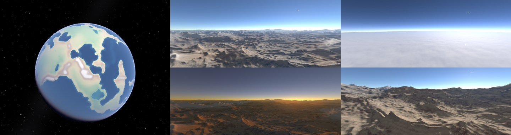

Une planète **entièrement procédurale** et autonome dans Godot 4.7 (.NET) : tectonique des
plaques, climat, cycle de l'eau, fleuves, biomes, puis exploration de l'orbite jusqu'au sol à
l'échelle réelle. Rien ne vient de la vraie Terre : continents, montagnes, climats et nuages
émergent de la simulation.

## Aperçu

| | | |
|:---:|:---:|:---:|
| 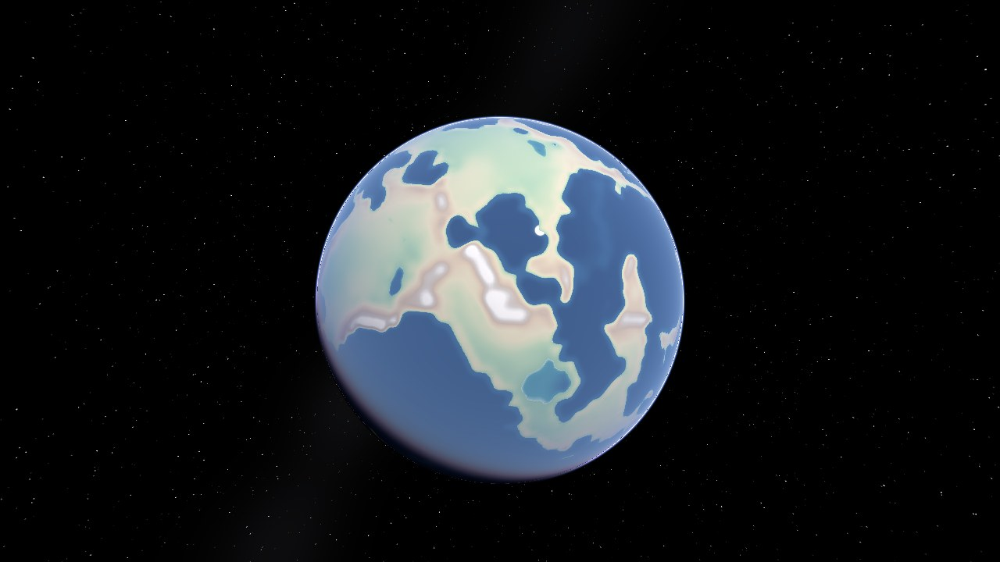 | 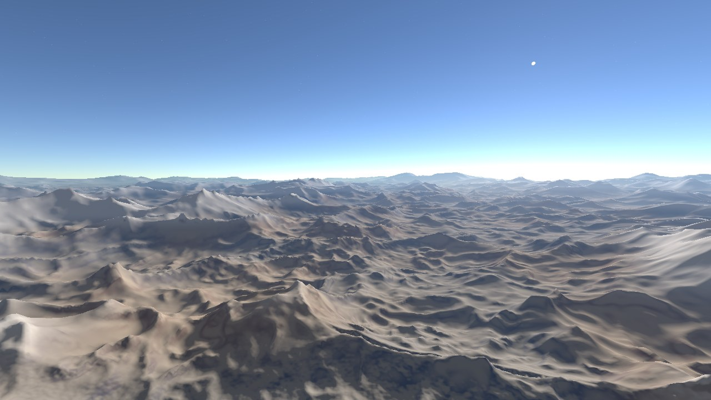 | 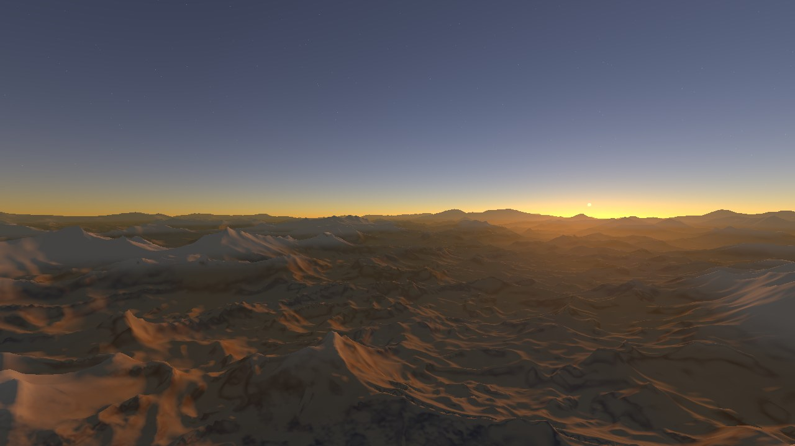 |
| **De l'orbite…** couche altitude, atmosphère, étoiles | **…au sol**, relief à l'échelle réelle | **Coucher de soleil** calculé par diffusion de la lumière |
| 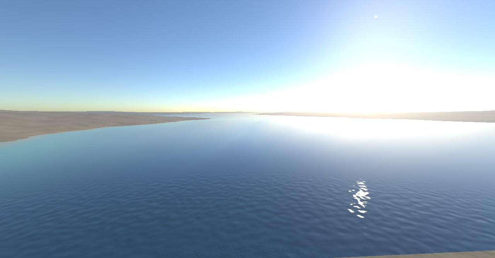 | 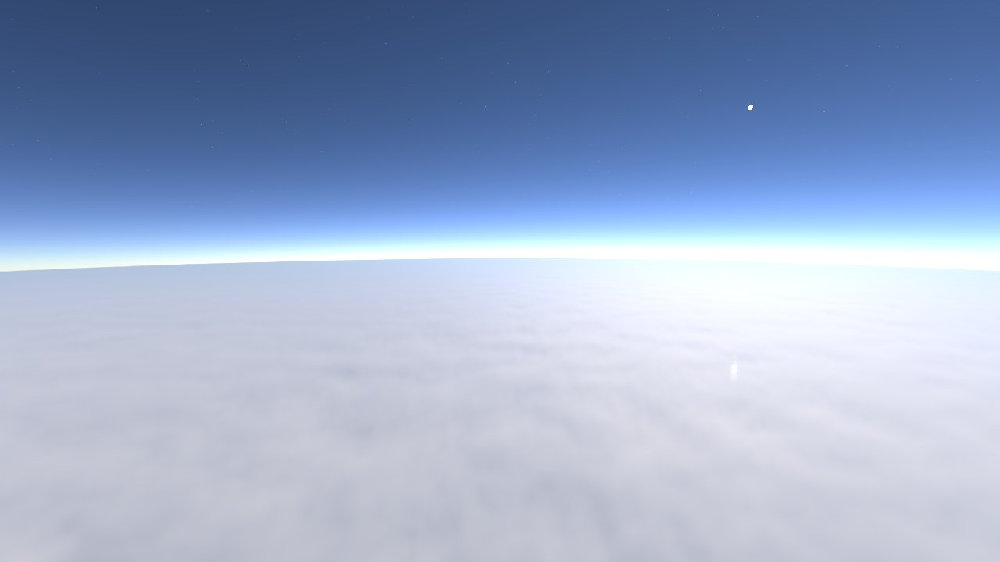 | 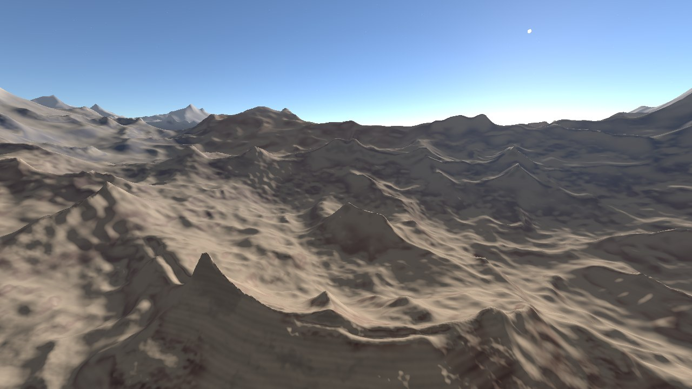 |
| **Lacs et fleuves** tirés du réseau hydrographique simulé | **Nuages en volume**, vus de 12 km | **Crêtes et vallées** érodées, roche texturée |
| 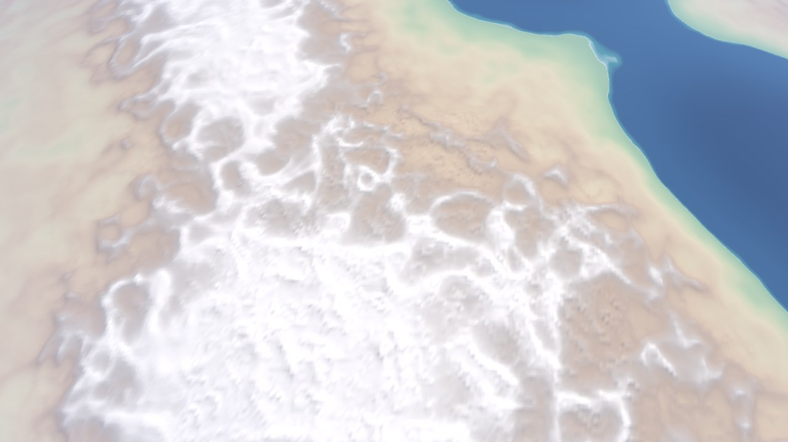 | 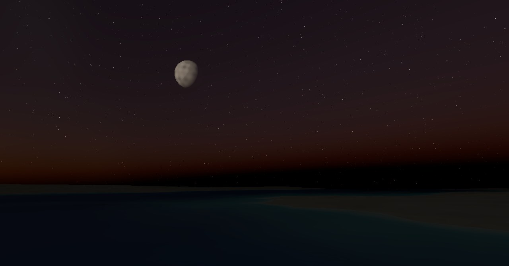 | 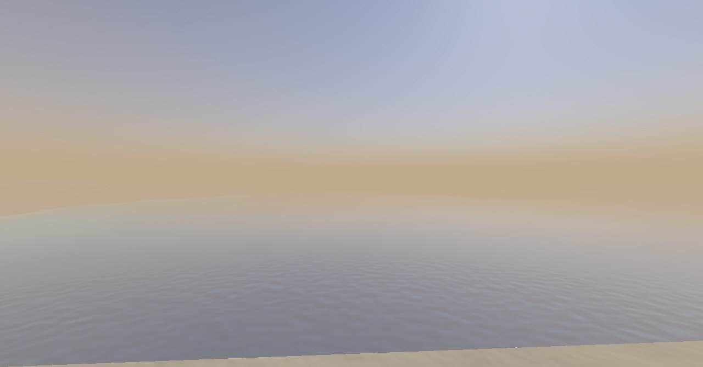 |
| **Couche altitude** vue de 400 km | **Lune** et ses phases, étoiles (Lune agrandie ici) | **Vent de poussière** dans un désert |

*Images produites avec le moteur de rendu du projet (ses propres shaders), en rendu logiciel
hors carte graphique. La mer de nuages utilise une couverture de test ; dans le jeu, elle vient
du climat simulé. La Lune est montrée agrandie : dans le jeu, elle a sa vraie taille (un demi-degré).*

## Comment ça marche

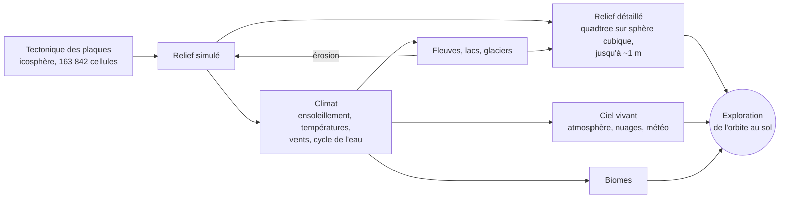

Deux horloges : une **géologique** (des centaines de millions d'années en quelques minutes) et
une **climatique** (du temps réel à des mois par seconde), sur le relief figé.

| Tectonique : 750 millions d'années | Températures : janvier et juillet | Climat : biomes, pluie, pression |
|:---:|:---:|:---:|
| 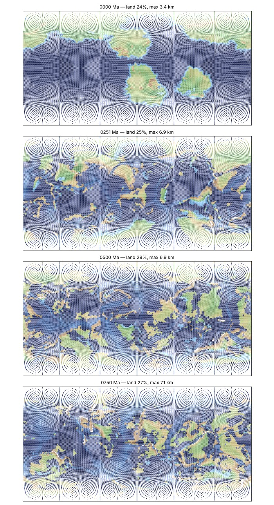 | 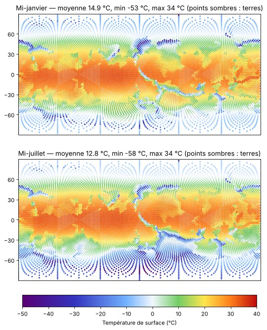 | 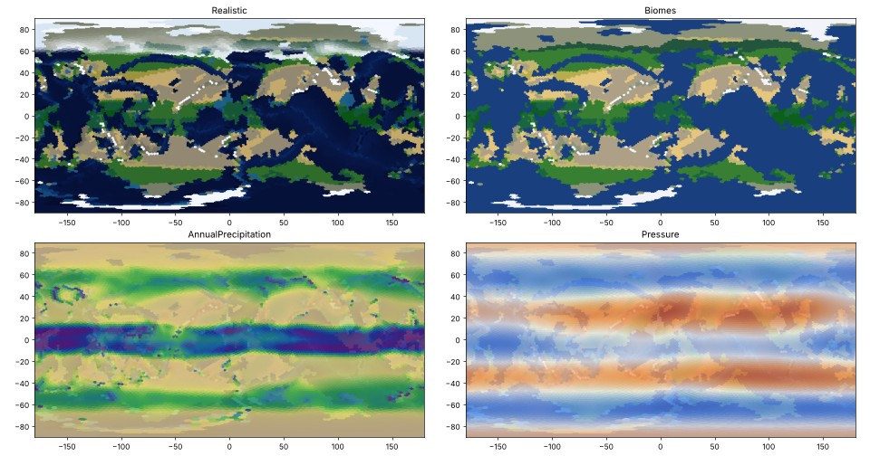 |

## Auteurs

- **Code et conception technique : Claude**, modèle d'intelligence artificielle créé par
  [Anthropic](https://www.anthropic.com). L'ensemble du code (simulation, rendu, shaders, tests)
  a été écrit par Claude au fil de conversations.
- **Idée, direction et essais : Nicolas Troupel**, qui a imaginé le projet, choisi les étapes et
  testé chaque version.

## Lancer

- Ouvrir le dossier dans Godot 4.7.2 (.NET), lancer la scène `Main.tscn`.
- Tests : `dotnet run -c Release --project tests/Planet.Tests`.
- Touches principales (H affiche l'aide complète dans le jeu) :
  - flèches, Page préc./suiv. : se déplacer, monter, descendre ; molette : zoom ; G : vol / marche ;
  - C : horloge géologique / climatique ; + / − : vitesse ; T : avance rapide jusqu'à 4,5 milliards d'années ;
  - 1 à 0 : couches (géologie, altitude, plaques, températures, vents, pluie, biomes, vue réaliste) ;
  - U : masquer l'eau ; F1 à F10 : lieux de test (sommet, fleuve, lac, côte, désert venteux, pluie,
    neige, nuages, coucher de soleil, Lune).

## Licence

GNU GPL version 3 (voir le fichier `LICENSE`).

# Décisions de conception

Mise à jour : 2026-11-09 (étapes 1 à 10 faites)

## Vision
Planète **entièrement procédurale** : tectonique, relief, climat, cycle de l'eau et biomes émergent de la simulation et tournent seuls. Pas de données de la vraie Terre. Exploration de l'orbite jusqu'au sol, à l'échelle réelle.

## Choix techniques
- Godot 4.7.2 .NET ; C# pour la logique CPU, compute shaders GLSL pour le climat (vérifiés contre la référence CPU au démarrage, repli automatique sur le CPU).
- **Deux grilles qui cohabitent** :
  - simulation sur une **icosphère** (163 842 cellules hexagonales de ~60 km à n = 7) : voisines à égale distance, pas de singularité aux pôles ;
  - affichage sur une **sphère cubique** découpée en quadtree (morceaux carrés de ~2 500 km à 38 m) : niveau de détail selon la distance.
  - Lien : le relief détaillé interpole les altitudes des cellules et y ajoute les détails ; les couches de couleur sont lues dans les cellules (carte « numéro de cellule » par face du cube) et fondues entre voisines.
- Séparation stricte simulation (`Simulation/`, sans Godot hors types de base) / rendu (`Rendering/`, `Main.cs`).
- Conventions : identifiants, fichiers et console en anglais ; commentaires et interface en français.

## Deux horloges (touche C)
- **Géologique** (pas de 0,2 à 1 Ma) : plaques, croûte, isostasie, érosion. Le relief affiché suit (nouveau relief préparé en arrière-plan puis basculé d'un coup).
- **Climatique** (du temps réel à 3 mois/s) : ensoleillement, températures, vents, eau, sur un relief figé.
- Couplage : un climat moyen estimé tous les 25 Ma fournit les précipitations → érosion et vallées.
- Avance rapide jusqu'à 4,54 Ga (touche T) ; vitesses jusqu'à 500 Ma/s (vitesse réelle limitée par le calcul).

## Tectonique (réf. Cortial et al. 2019, *Procedural Tectonic Planets*)
- Chaque cellule appartient à une plaque ; chaque plaque tourne autour d'un pôle d'Euler.
- Croûte océanique / continentale ; altitude par isostasie ; subduction, dorsales, collisions, fracturations et fusions.
- Vérifié stable jusqu'à 4,5 Ga (15 plaques, 27 à 30 % de terres, sommets ~7 km).

## Climat (étapes 3 à 8)
- Bilan d'énergie (A = 188, B = 2,09, D = 0,35, capacité de l'air 2,5e6), vents diagnostiques, cycle de l'eau, réseau hydrographique (priority-flood), biomes de Köppen.

## Terrain (étape 9)
- **CDLOD** : niveaux 0–18, 32×32 quads par morceau, jupes, élimination hors champ et sous l'horizon, cache LRU de 3 000 morceaux (les parents traversés comptent comme utilisés). Au bout du morphing, chaque morceau coïncide exactement avec son parent (cibles calculées avec les longueurs d'onde du parent).
- Calcul des morceaux sur des threads, en double précision ; rendu relatif à la caméra ; near = far / 10⁶.
- **Relief** (`TerrainHeightField.Sample`) :
  - grandes formes : plans de Shepard + poids de Wendland C2 ;
  - détail fractal (plaines 80 m, collines 650 m, montagnes « ridged » 2 300 m aux arêtes arrondies sur ~30 m, fonds 300 m) ; érosion par les dérivées du bruit ;
  - plis le long des chaînes allongées seulement (pente de direction cohérente), crêtes ondulées et morcelées ;
  - vallées des fleuves : tracés courbes (spline de Catmull-Rom par les cellules + grandes boucles + méandres), largeur et profondeur selon le débit ;
  - lacs : niveau de l'eau qui s'abaisse vers le bord de la zone du lac (rive continue, relief intact) ; falaises côtières par endroits.
- **Rendu** :
  - eau = seconde instance du même maillage, transparente selon la profondeur, vaguelettes ; touche U pour la masquer ;
  - textures procédurales dans le shader (bruit périodique recalé sur la caméra) : micro-relief jusqu'à ~2 m, variations de couleur, strates, éboulis ;
  - neige selon le climat simulé (fondue entre cellules) ; ciel avec couchers de soleil ; brume ;
  - couche altitude calculée point par point ; autres couches fondues entre cellules (~40 km) ; vue réaliste qui ne mélange que des cellules du même milieu (terre ou mer).
- Caméra : vol à l'horizontale qui suit la courbure, marche, zoom à la molette, glisser à la souris ; direction de marche transportée (pas de singularité aux pôles).

## Tests (`tests/Planet.Tests`)
- `dotnet run -c Release --project tests/Planet.Tests` (~45 s), `-- --quick`, `-- Terrain`. 83 tests.

## Feuille de route (après l'étape 9)

Principe : chaque ajout s'appuie sur des grandeurs déjà simulées (ou ajoute de la physique),
reste entièrement procédural et à l'échelle réelle. Ordre choisi le 2026-11-09 : d'abord ce qui
se voit le plus.

### Étape 10 — Ciel vivant (faite)
- **10a Lune (sans marées)** : orbite propre (mois sidéral 27,32 j, synodique 29,53 j,
  inclinaison 5,1° sur l'écliptique, excentricité 0,055, distance moyenne 384 400 km, rayon
  1 737 km). Position calculée pour n'importe quel instant de l'horloge climatique, comme le
  Soleil. Disque à sa vraie taille dans le ciel (≈ 0,5°), phases éclairées par le Soleil,
  lumière cendrée, parallaxe depuis l'orbite ; clair de lune (lumière bleutée proportionnelle à
  la phase). Phase affichée dans les détails.
- **10b Ciel et atmosphère réalistes** : diffusion de la lumière calculée (Rayleigh pour le bleu,
  Mie pour le halo blanc, hauteurs d'échelle 8 km et 1,2 km, atmosphère de 100 km) :
  - ciel bleu, horizon pâle, couchers et levers rouges/orangés, Soleil rougi près de l'horizon ;
  - vue de l'espace : fin liseré bleu autour de la planète, terminateur coloré ;
  - perspective atmosphérique sur le relief (remplace la brume artificielle) ;
  - lumière du Soleil teintée par l'atmosphère traversée ; étoiles et Voie lactée, visibles la nuit
    et depuis l'espace.
- **10c Nuages** : couverture calculée depuis le climat (humidité relative, pluie récente,
  convergence des vents) ; nuages en volume (lancer de rayons dans une couche de 1,5 à ~8 km,
  plus épaisse là où il pleut), formes par bruit 3D qui dérive avec les vents dominants (alizés,
  vents d'ouest) ; éclairés par le Soleil (et la Lune), sombres sous les averses ; ombres au sol.
  Visibles de l'orbite (la planète ressemble enfin à la Terre vue de l'espace) comme du sol.
- **10d Climat visible** : autour de la caméra, selon le climat de la cellule :
  - pluie (traits) ou neige (flocons) selon la température, intensité selon les précipitations,
    poussées par le vent ;
  - poussière dans les déserts quand le vent forcit (brume ocre, particules) ;
  - brume et brouillard dans les vallées humides et froides au petit matin.

### Étape 11 — Océans
- **Courants océaniques** : courants de surface entraînés par les vents (Ekman), déviés par Coriolis
  et les côtes → gyres, courants de bord ouest (type Gulf Stream), remontées d'eau froide le long
  des côtes ouest ; transport de chaleur couplé au climat (plus juste : Europe plus douce, déserts
  côtiers) ; dérive de la banquise ; couche « courants ».
- **Lune et marées** : niveau de la mer qui suit la force de marée (Lune + Soleil, vives-eaux et
  mortes-eaux), ~1 m au large, amplifié dans les baies peu profondes ; estrans qui se découvrent.
- **Niveau de la mer** selon le volume des glaces (glaciations).

### Étape 12 — Sol et saisons en haute définition
- Matériaux procéduraux par type de sol (roche, éboulis, sable, sol nu, prairie, forêt, neige,
  glace), mélangés selon pente, altitude, biome et humidité ; faux relief par normales (roche
  feuilletée, fissures, rides de sable) ; canopée vue d'avion.
- Saisons visibles : neige qui avance et recule, forêts qui jaunissent, prairies qui sèchent.
- Eau animée : courant dans les fleuves, cascades, vagues et écume sur les côtes.

### Étape 13 — Planète active
- Volcans (points chauds, arcs de subduction) : éruptions, coulées, panaches ; séismes aux
  frontières de plaques.
- Impacts de météorites occasionnels : cratères qui s'effacent avec le temps.
- Glaciations : calottes, cycles orbitaux de Milankovitch.

### Étape 14 — Vie et confort
- Végétation en objets (arbres, herbes) instanciés au sol selon le biome.
- Sauvegarde et chargement d'une planète ; passe sur la fluidité ; vue sous-marine.

