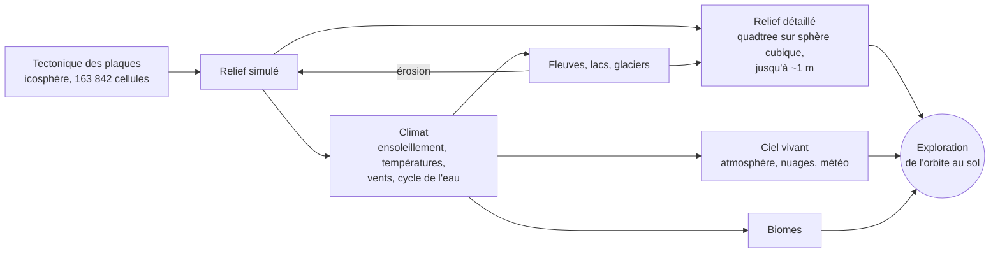

# Planet

Une planète **entièrement procédurale** et autonome dans Godot 4.7 (.NET) : tectonique des
plaques, climat, cycle de l'eau, fleuves, biomes, puis exploration de l'orbite jusqu'au sol à
l'échelle réelle. Rien ne vient de la vraie Terre : continents, montagnes, climats et nuages
émergent de la simulation.

## Aperçu

| | | |
|:---:|:---:|:---:|
|  |  |  |
| **De l'orbite…** couche altitude, atmosphère, étoiles | **…au sol**, relief à l'échelle réelle | **Coucher de soleil** calculé par diffusion de la lumière |
|  |  |  |
| **Lacs et fleuves** tirés du réseau hydrographique simulé | **Nuages en volume**, vus de 12 km | **Crêtes et vallées** érodées, roche texturée |
|  |  |  |
| **Couche altitude** vue de 400 km | **Lune** et ses phases, étoiles (Lune agrandie ici) | **Vent de poussière** dans un désert |

*Images produites avec le moteur de rendu du projet (ses propres shaders), en rendu logiciel
hors carte graphique. La mer de nuages utilise une couverture de test ; dans le jeu, elle vient
du climat simulé. La Lune est montrée agrandie : dans le jeu, elle a sa vraie taille (un demi-degré).*

## Comment ça marche

Deux horloges : une **géologique** (des centaines de millions d'années en quelques minutes) et
une **climatique** (du temps réel à des mois par seconde), sur le relief figé.

| Tectonique : 750 millions d'années | Températures : janvier et juillet | Climat : biomes, pluie, pression |
|:---:|:---:|:---:|
|  |  |  |

*Courants océaniques de surface : gyres refermés le long des continents, courants vers l'ouest
sous les tropiques, courant circumpolaire vers l'est autour de 50° S. Ils transportent la chaleur
des eaux de surface.*

## Auteurs

- **Code et conception technique : Claude**, modèle d'intelligence artificielle créé par
  [Anthropic](https://www.anthropic.com). L'ensemble du code (simulation, rendu, shaders, tests)
  a été écrit par Claude au fil de conversations.
- **Idée, direction et essais : Nicolas Troupel**, qui a imaginé le projet, choisi les étapes et
  testé chaque version.

## Lancer

- Ouvrir le dossier dans Godot 4.7.2 (.NET), lancer la scène `Main.tscn`.
- Tests : `dotnet run -c Release --project tests/Planet.Tests`.
- Touches principales (H affiche l'aide complète dans le jeu) :
  - flèches, Page préc./suiv. : se déplacer, monter, descendre ; molette : zoom ; G : vol / marche ;
  - C : horloge géologique / climatique ; + / − : vitesse ; T : avance rapide jusqu'à 4,5 milliards d'années ;
  - 1 à 0 : couches (géologie, altitude, plaques, températures, vents, pluie, biomes, vue réaliste) ;
    7 plusieurs fois : vent, pression, courants océaniques, remontées d'eau froide ;
  - I : détails (Lune, marée sous la caméra, niveau moyen de la mer…) ;
  - O : qualité d'image (résolution réduite + AMD FSR 1 ou 2 ; FSR 2 qualité au démarrage) ;
  - U : masquer l'eau ; F1 à F7 et F9 à F11 : lieux de test (sommet, fleuve, lac, côte, désert venteux,
    pluie, neige, puis nuages, coucher de soleil, Lune ; pas de F8, qui arrête le jeu lancé depuis l'éditeur).

## Licence

GNU GPL version 3 (voir le fichier `LICENSE`).

# Décisions de conception

Mise à jour : 2026-11-09 (étapes 1 à 12 faites)

## Vision
Planète **entièrement procédurale** : tectonique, relief, climat, cycle de l'eau et biomes émergent de la simulation et tournent seuls. Pas de données de la vraie Terre. Exploration de l'orbite jusqu'au sol, à l'échelle réelle.

## Choix techniques
- Godot 4.7.2 .NET ; C# pour la logique CPU, compute shaders GLSL pour le climat (vérifiés contre la référence CPU au démarrage, repli automatique sur le CPU).
- **Deux grilles qui cohabitent** :
  - simulation sur une **icosphère** (163 842 cellules hexagonales de ~60 km à n = 7) : voisines à égale distance, pas de singularité aux pôles ;
  - affichage sur une **sphère cubique** découpée en quadtree (morceaux carrés de ~2 500 km à 38 m) : niveau de détail selon la distance.
  - Lien : le relief détaillé interpole les altitudes des cellules et y ajoute les détails ; les couches de couleur sont lues dans les cellules (carte « numéro de cellule » par face du cube) et fondues entre voisines.
- Séparation stricte simulation (`Simulation/`, sans Godot hors types de base) / rendu (`Rendering/`, `Main.cs`).
- Conventions : identifiants, fichiers et console en anglais ; commentaires et interface en français.

## Deux horloges (touche C)
- **Géologique** (pas de 0,2 à 1 Ma) : plaques, croûte, isostasie, érosion. Le relief affiché suit (nouveau relief préparé en arrière-plan puis basculé d'un coup).
- **Climatique** (du temps réel à 3 mois/s) : ensoleillement, températures, vents, eau, sur un relief figé.
- Couplage : un climat moyen estimé tous les 25 Ma fournit les précipitations → érosion et vallées.
- Avance rapide jusqu'à 4,54 Ga (touche T) ; vitesses jusqu'à 500 Ma/s (vitesse réelle limitée par le calcul).

## Tectonique (réf. Cortial et al. 2019, *Procedural Tectonic Planets*)
- Chaque cellule appartient à une plaque ; chaque plaque tourne autour d'un pôle d'Euler.
- Croûte océanique / continentale ; altitude par isostasie ; subduction, dorsales, collisions, fracturations et fusions.
- Vérifié stable jusqu'à 4,5 Ga (15 plaques, 27 à 30 % de terres, sommets ~7 km).

## Climat (étapes 3 à 8)
- Bilan d'énergie (A = 188, B = 2,09, D = 0,35, capacité de l'air 2,5e6), vents diagnostiques, cycle de l'eau, réseau hydrographique (priority-flood), biomes de Köppen.

## Terrain (étape 9)
- **CDLOD** : niveaux 0–18, 32×32 quads par morceau, jupes, élimination hors champ et sous l'horizon, cache LRU de 3 000 morceaux (les parents traversés comptent comme utilisés). Au bout du morphing, chaque morceau coïncide exactement avec son parent (cibles calculées avec les longueurs d'onde du parent).
- Calcul des morceaux sur des threads, en double précision ; rendu relatif à la caméra ; near = far / 10⁶.
- **Relief** (`TerrainHeightField.Sample`) :
  - grandes formes : plans de Shepard + poids de Wendland C2 ;
  - détail fractal (plaines 80 m, collines 650 m, montagnes « ridged » 2 300 m aux arêtes arrondies sur ~30 m, fonds 300 m) ; érosion par les dérivées du bruit ;
  - plis le long des chaînes allongées seulement (pente de direction cohérente), crêtes ondulées et morcelées ;
  - vallées des fleuves : tracés courbes (spline de Catmull-Rom par les cellules + grandes boucles + méandres), largeur et profondeur selon le débit ;
  - lacs : niveau de l'eau qui s'abaisse vers le bord de la zone du lac (rive continue, relief intact) ; falaises côtières par endroits.
- **Rendu** :
  - eau = seconde instance du même maillage, transparente selon la profondeur, vaguelettes ; touche U pour la masquer ;
  - textures procédurales dans le shader (bruit périodique recalé sur la caméra) : micro-relief jusqu'à ~2 m, variations de couleur, strates, éboulis ;
  - neige selon le climat simulé (fondue entre cellules) ; ciel avec couchers de soleil ; brume ;
  - couche altitude calculée point par point ; autres couches fondues entre cellules (~40 km) ; vue réaliste qui ne mélange que des cellules du même milieu (terre ou mer).
- Caméra : vol à l'horizontale qui suit la courbure, marche, zoom à la molette, glisser à la souris ; direction de marche transportée (pas de singularité aux pôles).

## Tests (`tests/Planet.Tests`)
- `dotnet run -c Release --project tests/Planet.Tests` (~45 s), `-- --quick`, `-- Terrain`. 83 tests.

## Feuille de route (après l'étape 9)

Principe : chaque ajout s'appuie sur des grandeurs déjà simulées (ou ajoute de la physique),
reste entièrement procédural et à l'échelle réelle. Ordre choisi le 2026-11-09 : d'abord ce qui
se voit le plus.

### Étape 10 — Ciel vivant (faite)
- **10a Lune (sans marées)** : orbite propre (mois sidéral 27,32 j, synodique 29,53 j,
  inclinaison 5,1° sur l'écliptique, excentricité 0,055, distance moyenne 384 400 km, rayon
  1 737 km). Position calculée pour n'importe quel instant de l'horloge climatique, comme le
  Soleil. Disque à sa vraie taille dans le ciel (≈ 0,5°), phases éclairées par le Soleil,
  lumière cendrée, parallaxe depuis l'orbite ; clair de lune (lumière bleutée proportionnelle à
  la phase). Phase affichée dans les détails.
- **10b Ciel et atmosphère réalistes** : diffusion de la lumière calculée (Rayleigh pour le bleu,
  Mie pour le halo blanc, hauteurs d'échelle 8 km et 1,2 km, atmosphère de 100 km) :
  - ciel bleu, horizon pâle, couchers et levers rouges/orangés, Soleil rougi près de l'horizon ;
  - vue de l'espace : fin liseré bleu autour de la planète, terminateur coloré ;
  - perspective atmosphérique sur le relief (remplace la brume artificielle) ;
  - lumière du Soleil teintée par l'atmosphère traversée ; étoiles et Voie lactée, visibles la nuit
    et depuis l'espace.
- **10c Nuages** : couverture calculée depuis le climat (humidité relative, pluie récente,
  convergence des vents) ; nuages en volume (lancer de rayons dans une couche de 1,5 à ~8 km,
  plus épaisse là où il pleut), formes par bruit 3D qui dérive avec les vents dominants (alizés,
  vents d'ouest) ; éclairés par le Soleil (et la Lune), sombres sous les averses ; ombres au sol.
  Visibles de l'orbite (la planète ressemble enfin à la Terre vue de l'espace) comme du sol.
- **10d Climat visible** : autour de la caméra, selon le climat de la cellule :
  - pluie (traits) ou neige (flocons) selon la température, intensité selon les précipitations,
    poussées par le vent ;
  - poussière dans les déserts quand le vent forcit (brume ocre, particules) ;
  - brume et brouillard dans les vallées humides et froides au petit matin.

### Étape 11 — Océans (faite)
- **11a Courants océaniques** : modèle de Stommel (1948) résolu sur une grille de ~110 km
  (r ∇²ψ + β ∂ψ/∂x = rot τ / ρH, ψ = 0 sur les côtes, couche de 100 m, courants de bord ouest
  larges de ~350 km) plus dérive d'Ekman (1,2 % du vent, déviée de 45°) ; recalculés en tâche de
  fond tous les 5 jours simulés ; transport de la chaleur des eaux de surface couplé au climat (sur
  la carte graphique et le processeur, efficacité 50 %) ; couche « courants » (touche 7) et flèches (V).
  Vérifié sur un océan d'école : gyres dans le bon sens dans les deux hémisphères, courant de
  bord ouest ~4 fois plus rapide qu'à l'est.
- **11b Marées** : marée d'équilibre de Newton, η = K (cos²θ − 1/3) pour la Lune et pour le
  Soleil, K = 3/2 (m/M)(R/d)³ R (0,54 m et 0,25 m ; la Lune au périgée donne ~20 % de plus) ;
  amplification côtière moyenne ×3 faute de modèle de propagation des ondes (marnage de
  vives-eaux ~2,3 m, de mortes-eaux ~0,6 m). La mer monte et descend dans le shader de l'eau,
  les côtes basses et les embouchures sont inondées à marée haute, l'estran se découvre (sable
  mouillé plus sombre et brillant). Marée sous la caméra dans les détails (touche I). Vérifié :
  une marée haute toutes les 12 h 25, volume d'eau conservé, rapport vives-eaux / mortes-eaux.
- **11c Remontées d'eau froide** : transport d'Ekman M = τ × k / (ρ f) sur toute la couche
  entraînée par le vent ; là où il diverge (côte ouest d'un continent avec un vent vers
  l'équateur, équateur sous les alizés), l'eau de la thermocline remonte (w = div M) et refroidit
  la surface (au plus 6 °C plus froide, jamais sous 8 °C, efficacité 30 %), sur la carte
  graphique comme sur le processeur. Couche « remontées d'eau froide » (touche 7). Effet global :
  tropiques −1,3 °C, planète −0,9 °C.
- **11d Niveau de la mer** : la neige et la glace posées sur les terres sont prises à l'océan
  (volume en équivalent eau / surface des océans) ; référence 0 m = aucune glace sur les terres.
  La côte affichée suit ce niveau (le masque terre/mer du climat, lui, ne change pas). Les grandes
  variations viendront avec les glaciations (étape 13).
- **11e Banquise qui dérive** : concentration de glace transportée par le courant de surface et
  ~2 % du vent dévié de 20° (règle de Nansen), schéma amont conservatif qui ne traverse pas les
  côtes ; formation en ~10 jours, fonte en ~30 jours (langues de glace à la dérive). Affichée
  dans la vue réaliste ; le climat garde sa banquise déduite de la température.

### Étape 12 — Sol et saisons en haute définition (faite)
- **12a Matériaux** : sable des plages et des déserts en dunes dissymétriques (~32 m) et rides
  (~0,5 m) ; roche fissurée (réseau de diaclases) en plus des strates et des éboulis ; canopée
  des forêts vue d'avion (houppiers de ~8 m, trouées d'ombre), plus clairsemée quand les feuillus
  ont perdu leurs feuilles.
- **12b Saisons** : feuillus qui jaunissent et rougissent quand la température moyenne des
  10 derniers jours passe sous 9 °C (ou que le sol s'assèche, en forêt tropicale sèche), perdent
  leurs feuilles en ~1 mois et reverdissent au-dessus de 10 °C ; herbes qui virent à la paille en
  saison sèche ou en hiver ; neige qui avance et recule (climat simulé). Parts de forêt, de
  feuillus et d'herbe selon le biome.
- **12c Eau animée** : courant visible dans les fleuves (vaguelettes entraînées vers l'aval,
  plus vite sur les pentes), eaux blanches dans les rapides et les cascades ; houle du large
  (~128 et ~512 m) qui s'atténue sur les hauts-fonds ; rouleaux d'écume qui avancent vers le
  rivage et frange d'écume au bord de l'eau.
- **Nuages** (correction) : la couverture du climat, moyenne sur des jours, formait des anneaux
  le long des latitudes ; un « temps qu'il fait » procédural (systèmes de 500 à 1 500 km qui
  dérivent avec les vents dominants et se renouvellent en ~1 jour) la découpe en nuages et en
  éclaircies, les averses se regroupent en amas d'orages.

### Étape 13 — Planète active
- Volcans (points chauds, arcs de subduction) : éruptions, coulées, panaches ; séismes aux
  frontières de plaques.
- Impacts de météorites occasionnels : cratères qui s'effacent avec le temps.
- Glaciations : calottes, cycles orbitaux de Milankovitch.

### Étape 14 — Vie et confort
- Végétation en objets (arbres, herbes) instanciés au sol selon le biome.
- Sauvegarde et chargement d'une planète ; passe sur la fluidité ; vue sous-marine.

# Sources et références

Les modèles du projet sont des versions simplifiées de travaux publiés. Voici, pour chaque
partie, les articles et ouvrages dont viennent les équations, les algorithmes et les valeurs
utilisés. Les constantes « de la Terre » (masses, distances, durées) sont les valeurs standard
de ces mêmes ouvrages.

## Grille et géométrie
- Sadourny R., Arakawa A., Mintz Y. (1968). *Integration of the nondivergent barotropic vorticity
  equation with an icosahedral-hexagonal grid for the sphere.* Monthly Weather Review 96(6),
  351-356. — icosphère de la simulation.
- Ronchi C., Iacono R., Paolucci P. S. (1996). *The "Cubed Sphere": a new method for the solution
  of partial differential equations in spherical geometry.* Journal of Computational Physics
  124(1), 93-114. — sphère cubique en projection équi-angulaire (terrain, textures des nuages).

## Tectonique et relief
- Cortial Y., Peytavie A., Galin É., Guérin É. (2019). *Procedural Tectonic Planets.* Computer
  Graphics Forum 38(2), 1-11. — plaques, subduction, collisions, fracturations : modèle de départ.
- Cox A., Hart R. B. (1986). *Plate Tectonics: How It Works.* Blackwell. — rotation des plaques
  autour d'un pôle d'Euler.
- Airy G. B. (1855). *On the computation of the effect of the attraction of mountain-masses, as
  disturbing the apparent astronomical latitude of stations in geodetic surveys.* Philosophical
  Transactions of the Royal Society 145, 101-104. — isostasie (altitude selon l'épaisseur de croûte).
- Shepard D. (1968). *A two-dimensional interpolation function for irregularly-spaced data.*
  Proceedings of the 23rd ACM National Conference, 517-524. — mélange des plans des cellules.
- Wendland H. (1995). *Piecewise polynomial, positive definite and compactly supported radial
  functions of minimal degree.* Advances in Computational Mathematics 4, 389-396. — poids C2.
- Perlin K. (2002). *Improving noise.* ACM Transactions on Graphics 21(3), 681-682. — bruit de
  gradient (interpolation quintique).
- Ebert D. S., Musgrave F. K., Peachey D., Perlin K., Worley S. (2003). *Texturing and Modeling:
  A Procedural Approach*, 3e éd. Morgan Kaufmann. — fractales, bruit « ridged » des montagnes.
- Quilez I. *Gradient noise derivatives* (article, iquilezles.org). — bruit avec ses dérivées
  analytiques (érosion apparente du relief, micro-relief des shaders).
- Catmull E., Rom R. (1974). *A class of local interpolating splines.* In Barnhill R. E.,
  Riesenfeld R. F. (éd.), Computer Aided Geometric Design, Academic Press, 317-326. — tracé
  courbe des fleuves.
- Bagnold R. A. (1941). *The Physics of Blown Sand and Desert Dunes.* Methuen. — profil
  dissymétrique des dunes (pente douce au vent, raide sous le vent), rides de sable.

## Ensoleillement, orbites, Lune, marées
- Meeus J. (1998). *Astronomical Algorithms*, 2e éd. Willmann-Bell. — orbite de Kepler, équation
  de Kepler, coordonnées écliptiques et équatoriales, éléments moyens de l'orbite lunaire
  (mois sidéral, anomalistique, régression des nœuds, inclinaison, excentricité).
- Berger A. (1978). *Long-term variations of daily insolation and Quaternary climatic changes.*
  Journal of the Atmospheric Sciences 35(12), 2362-2367. — ensoleillement moyen sur 24 h.
- Newton I. (1687). *Philosophiae Naturalis Principia Mathematica.* — théorie de la marée
  d'équilibre.
- Pugh D., Woodworth P. (2014). *Sea-Level Science: Understanding Tides, Surges, Tsunamis and
  Mean Sea-Level Changes.* Cambridge University Press. — amplitude de la marée d'équilibre,
  vives-eaux et mortes-eaux, amplification sur les côtes.

## Climat
- Budyko M. I. (1969). *The effect of solar radiation variations on the climate of the Earth.*
  Tellus 21(5), 611-619.
- Sellers W. D. (1969). *A global climatic model based on the energy balance of the
  earth-atmosphere system.* Journal of Applied Meteorology 8(3), 392-400.
- North G. R., Cahalan R. F., Coakley J. A. (1981). *Energy balance climate models.* Reviews of
  Geophysics and Space Physics 19(1), 91-121. — rayonnement sortant linéaire A + B·T, diffusion
  de la chaleur (bilan d'énergie de l'étape 4).
- Hartmann D. L. (2016). *Global Physical Climatology*, 2e éd. Elsevier. — albédos, capacités
  calorifiques, évaporation, relation de Clausius-Clapeyron.
- Holton J. R., Hakim G. J. (2013). *An Introduction to Dynamic Meteorology*, 5e éd. Academic
  Press. — circulation générale, équilibre pression / Coriolis / frottement des vents
  diagnostiques.
- ISO 2533:1975. *Atmosphère type.* — gradient de température de 6,5 °C par km.
- Hock R. (2003). *Temperature index melt modelling in mountain areas.* Journal of Hydrology
  282, 104-115. — fonte de la neige par degrés-jours.
- Köppen W. (1936). *Das geographische System der Klimate.* In Köppen W., Geiger R. (éd.),
  Handbuch der Klimatologie, Borntraeger ; Kottek M. et al. (2006). *World map of the
  Köppen-Geiger climate classification updated.* Meteorologische Zeitschrift 15(3), 259-263. —
  biomes et seuil d'aridité.

## Eau douce
- Barnes R., Lehman C., Mulla D. (2014). *Priority-flood: an optimal depression-filling and
  watershed-labeling algorithm for digital elevation models.* Computers & Geosciences 62,
  117-127. — remplissage des cuvettes, lacs.
- O'Callaghan J. F., Mark D. M. (1984). *The extraction of drainage networks from digital
  elevation data.* Computer Vision, Graphics, and Image Processing 28(3), 323-344. — écoulement
  vers la voisine la plus basse, débits cumulés vers l'aval.

## Océans
- Stommel H. (1948). *The westward intensification of wind-driven ocean currents.* Transactions
  of the American Geophysical Union 29(2), 202-206. — gyres et courants de bord ouest (11a).
- Ekman V. W. (1905). *On the influence of the earth's rotation on ocean-currents.* Arkiv för
  Matematik, Astronomi och Fysik 2(11), 1-52. — dérive de surface et transport d'Ekman,
  remontées d'eau froide (11a, 11c).
- Talley L. D., Pickard G. L., Emery W. J., Swift J. H. (2011). *Descriptive Physical
  Oceanography: An Introduction*, 6e éd. Academic Press. — remontées côtières et équatoriales,
  thermocline, ordres de grandeur.
- Nansen F. (1902). *The oceanography of the North Polar Basin.* The Norwegian North Polar
  Expedition 1893-1896, Scientific Results 3(9). — dérive de la banquise à ~2 % du vent, déviée
  vers la droite (11e).
- Leppäranta M. (2011). *The Drift of Sea Ice*, 2e éd. Springer. — dérive et transport de la
  banquise.
- Lambeck K., Rouby H., Purcell A., Sun Y., Sambridge M. (2014). *Sea level and global ice
  volumes from the Last Glacial Maximum to the Holocene.* PNAS 111(43), 15296-15303 ;
  GIEC (2021). *AR6, groupe de travail I, chapitre 9 : Ocean, Cryosphere and Sea Level Change.*
  — niveau de la mer et volume des glaces (11d).

## Végétation et saisons
- White M. A., Thornton P. E., Running S. W. (1997). *A continental phenology model for
  monitoring vegetation responses to interannual climatic variability.* Global Biogeochemical
  Cycles 11(2), 217-234. — débourrement et sénescence selon la température et l'eau du sol.
- Delpierre N. et al. (2009). *Modelling interannual and spatial variability of leaf senescence
  for three deciduous tree species in France.* Agricultural and Forest Meteorology 149,
  938-948. — jaunissement des feuilles quand il fait plus froid.

## Rendu
- Strugar F. (2009). *Continuous Distance-Dependent Level of Detail for Rendering Heightmaps.*
  Journal of Graphics, GPU, and Game Tools 14(4), 57-74. — CDLOD : quadtree, morphing.
- Rayleigh (Lord) (1871). *On the light from the sky, its polarization and colour.*
  Philosophical Magazine 41, 107-120 ; Mie G. (1908). *Beiträge zur Optik trüber Medien.*
  Annalen der Physik 330(3), 377-445. — diffusion par les molécules et les aérosols.
- Nishita T., Sirai T., Tadamura K., Nakamae E. (1993). *Display of the Earth taking into
  account atmospheric scattering.* SIGGRAPH '93, 175-182. — ciel vu du sol et de l'espace.
- Bruneton E., Neyret F. (2008). *Precomputed atmospheric scattering.* Computer Graphics Forum
  27(4), 1079-1086. — coefficients de Rayleigh et de Mie, hauteurs d'échelle, g = 0,76.
- Cornette W. M., Shanks J. G. (1992). *Physically reasonable analytic expression for the
  single-scattering phase function.* Applied Optics 31(16), 3152-3160. — fonction de phase de Mie.
- Hillaire S. (2020). *A scalable and production ready sky and atmosphere rendering technique.*
  Computer Graphics Forum 39(4), 13-22. — absorption par l'ozone.
- Schneider A., Vos N. (2015). *The real-time volumetric cloudscapes of Horizon Zero Dawn.*
  SIGGRAPH, Advances in Real-Time Rendering in Games. — nuages en volume : marche de rayons,
  loi de Beer, effet « powder », bruit à plusieurs échelles.
- Blinn J. F. (1977). *Models of light reflection for computer synthesized pictures.* SIGGRAPH
  Computer Graphics 11(2), 192-198. — reflets (Blinn-Phong) ; diffusion de Lambert.
- AMD (2021, 2022). *FidelityFX Super Resolution 1 et 2.* — agrandissement de l'image (touche O),
  fourni par Godot.
