# Planet

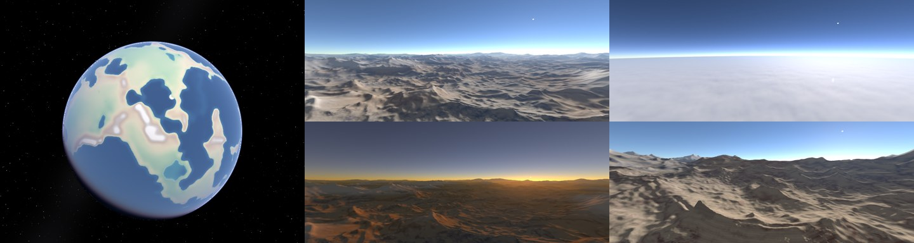

Une planète **entièrement procédurale** et autonome dans Godot 4.7 (.NET) : tectonique des
plaques, climat, cycle de l'eau, fleuves, biomes, puis exploration de l'orbite jusqu'au sol à
l'échelle réelle. Rien ne vient de la vraie Terre : continents, montagnes, climats et nuages
émergent de la simulation.

## Aperçu

| | | |
|:---:|:---:|:---:|
| 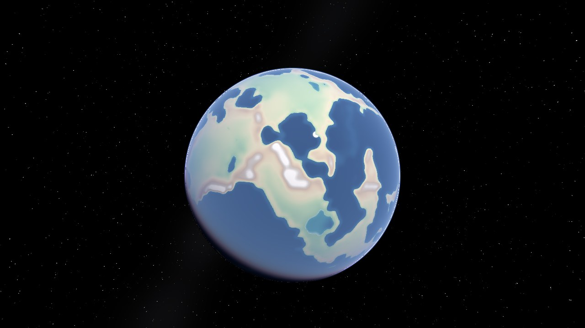 | 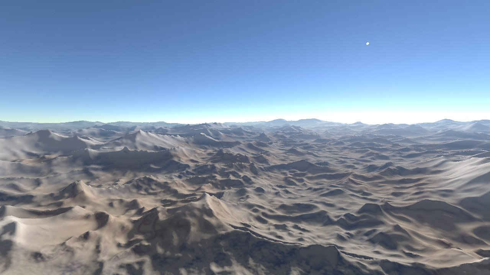 | 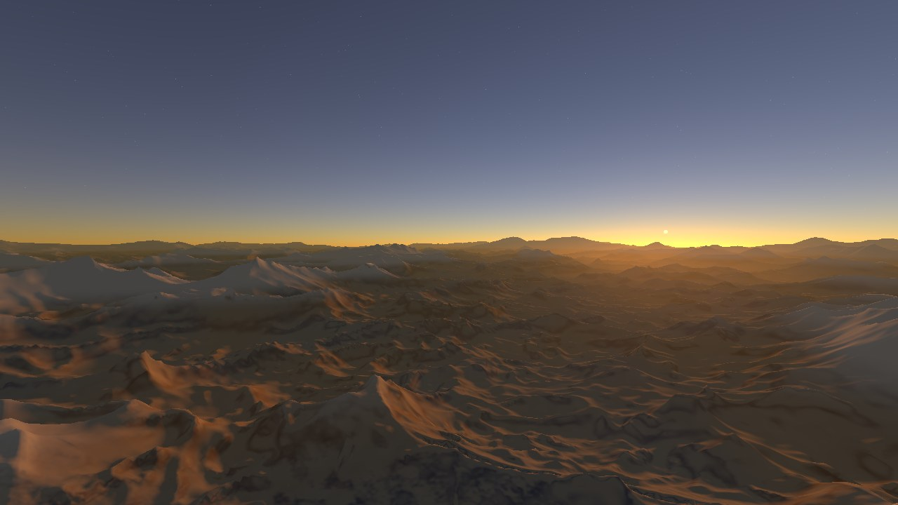 |
| **De l'orbite…** vue réaliste, nuages du climat simulé | **…au sol**, relief à l'échelle réelle | **Coucher de soleil** calculé par diffusion de la lumière |
| 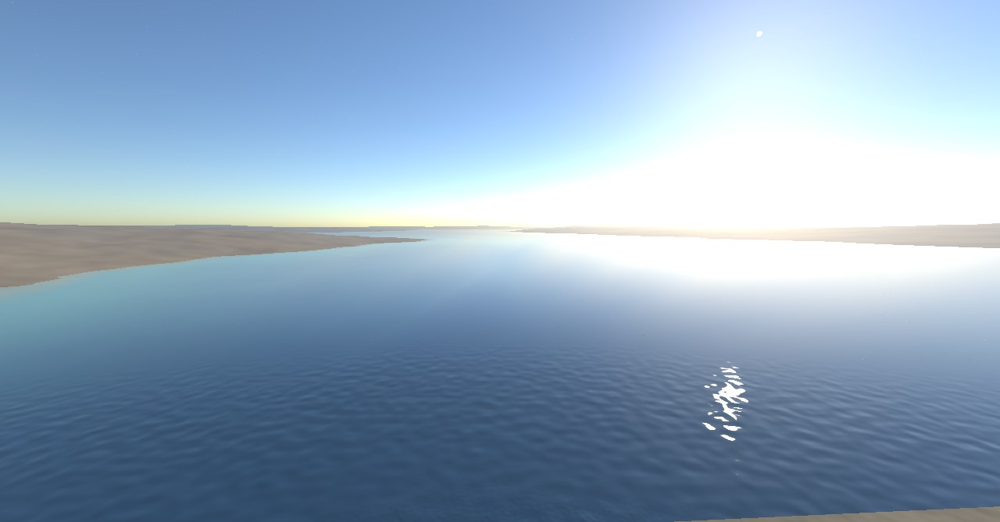 | 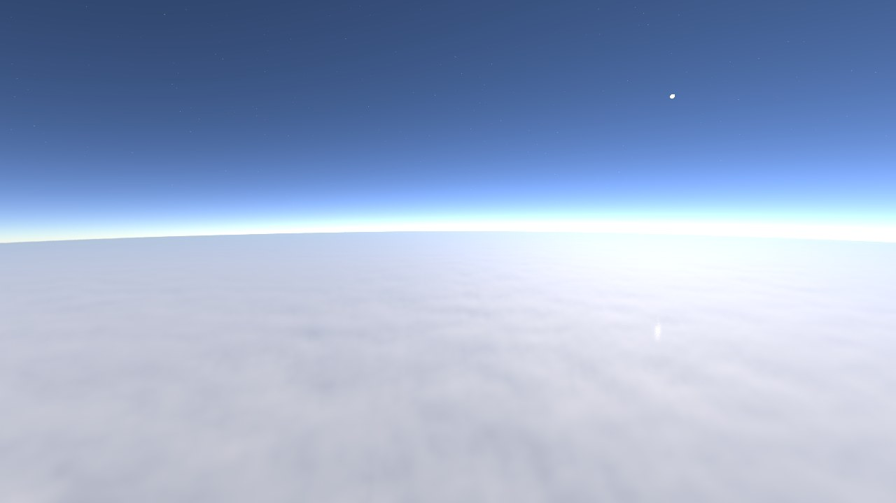 | 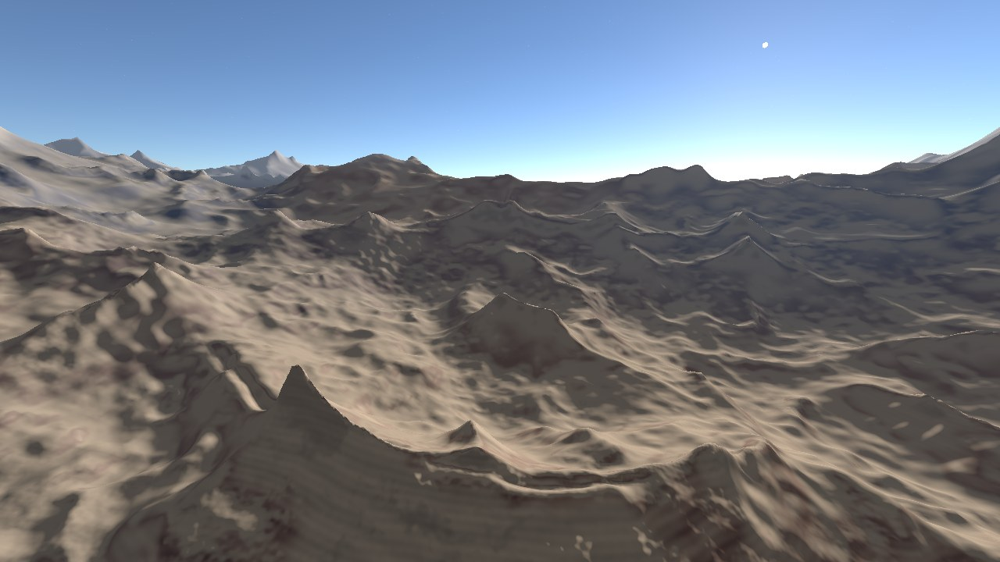 |
| **Lacs et fleuves** tirés du réseau hydrographique simulé | **Nuages en volume**, vus de 12 km | **Crêtes et vallées** érodées, roche texturée |
| 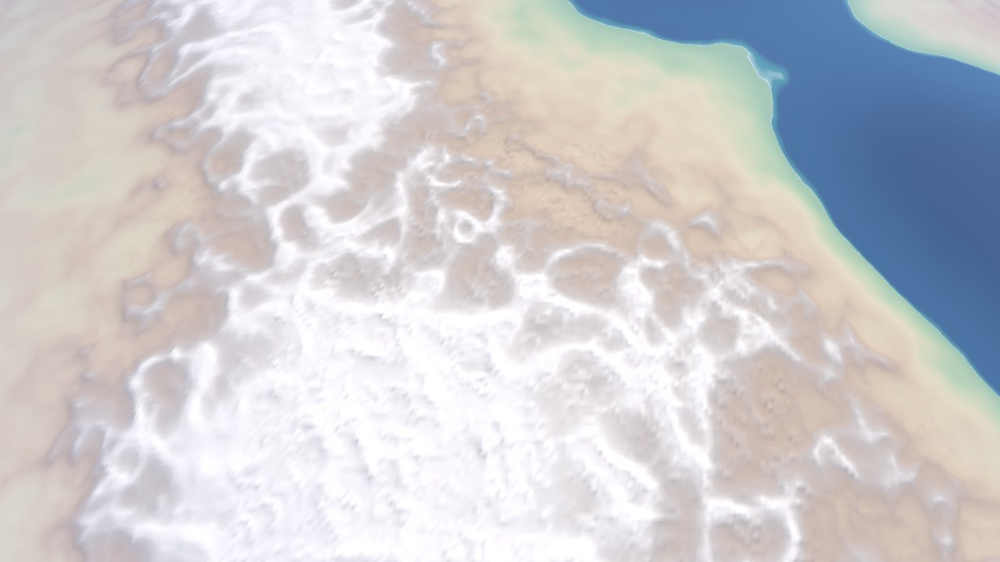 | 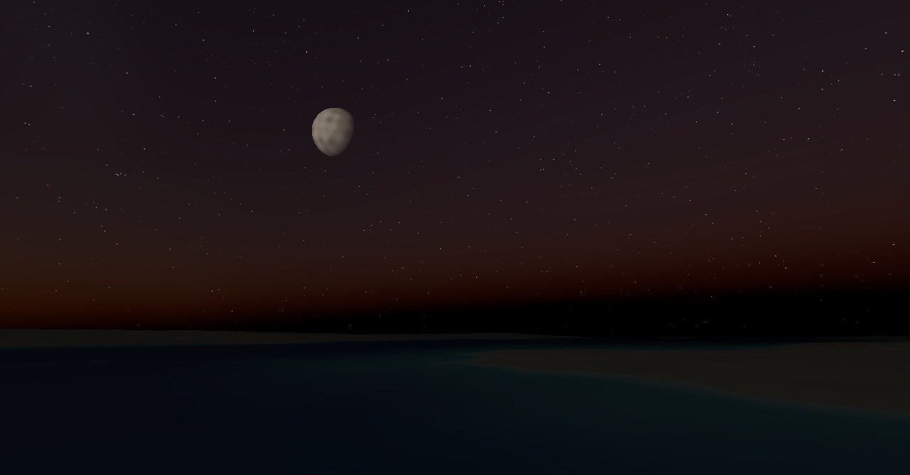 | 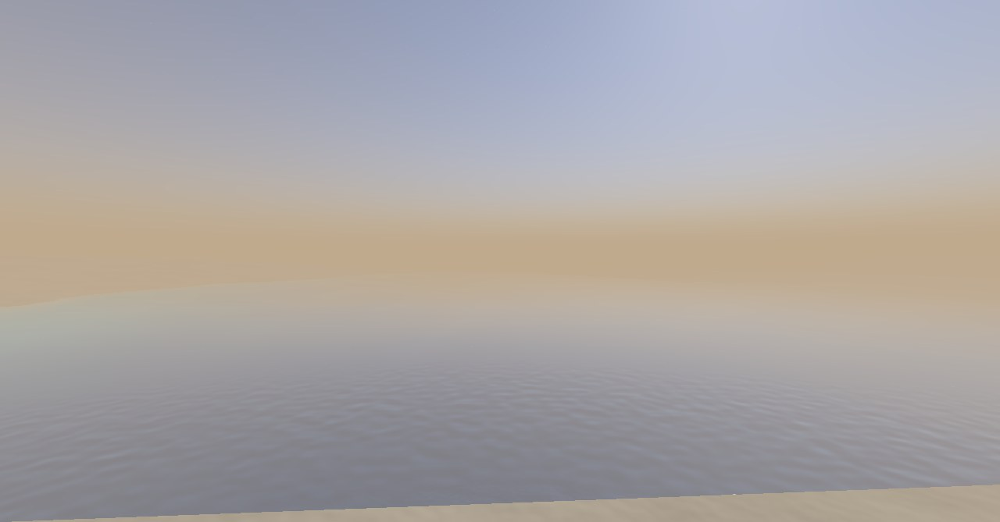 |
| **Couche altitude** vue de 400 km | **Lune** et ses phases, étoiles (Lune agrandie ici) | **Vent de poussière** dans un désert |

*Images produites avec le moteur de rendu du projet (ses propres shaders), en rendu logiciel
hors carte graphique. La vue d'orbite utilise le climat simulé (couleurs, nuages) ; la mer de
nuages, une couverture de test. La Lune est montrée agrandie : dans le jeu, elle a sa vraie
taille (un demi-degré).*

## Comment ça marche

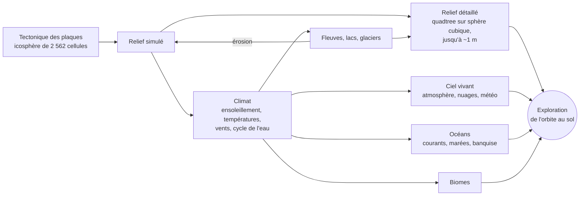

Deux horloges : une **géologique** (des centaines de millions d'années en quelques minutes) et
une **climatique** (du temps réel à des mois par seconde), sur le relief figé.

| Tectonique : 750 millions d'années | Températures : janvier et juillet | Climat : biomes, pluie, pression |
|:---:|:---:|:---:|
| 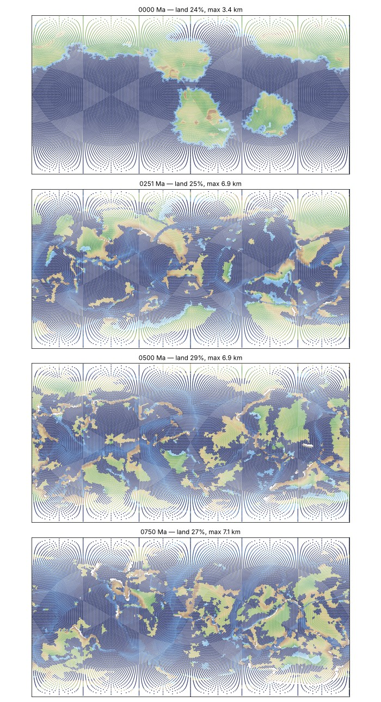 | 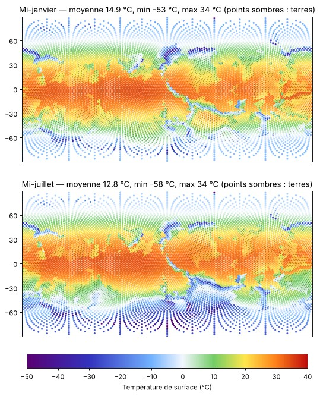 | 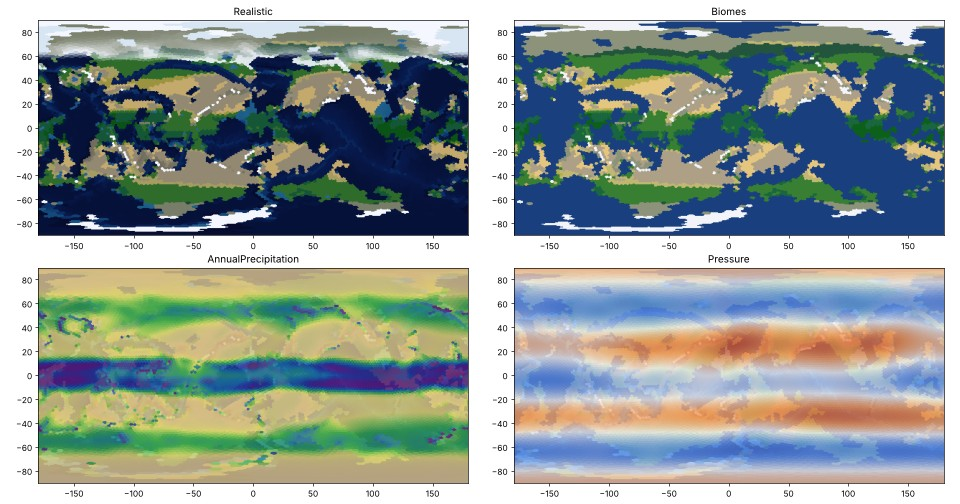 |

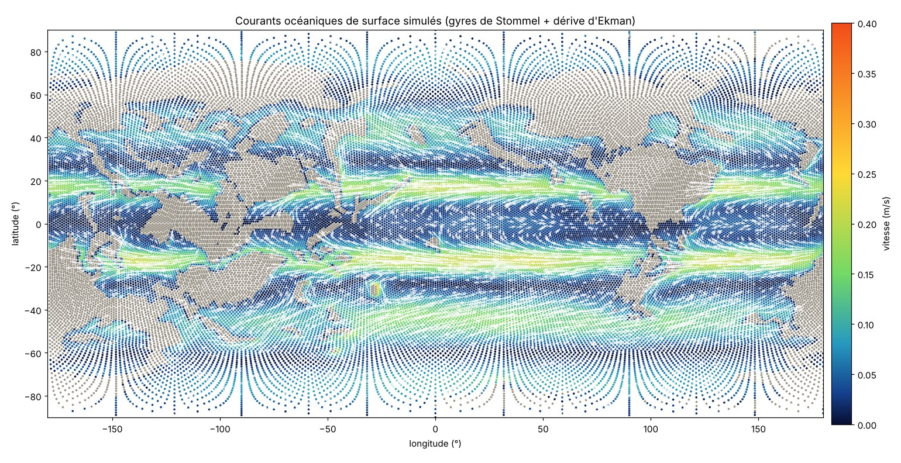

*Courants océaniques de surface : gyres refermés le long des continents, courants vers l'ouest
sous les tropiques, courant circumpolaire vers l'est autour de 50° S. Ils transportent la chaleur
des eaux de surface.*

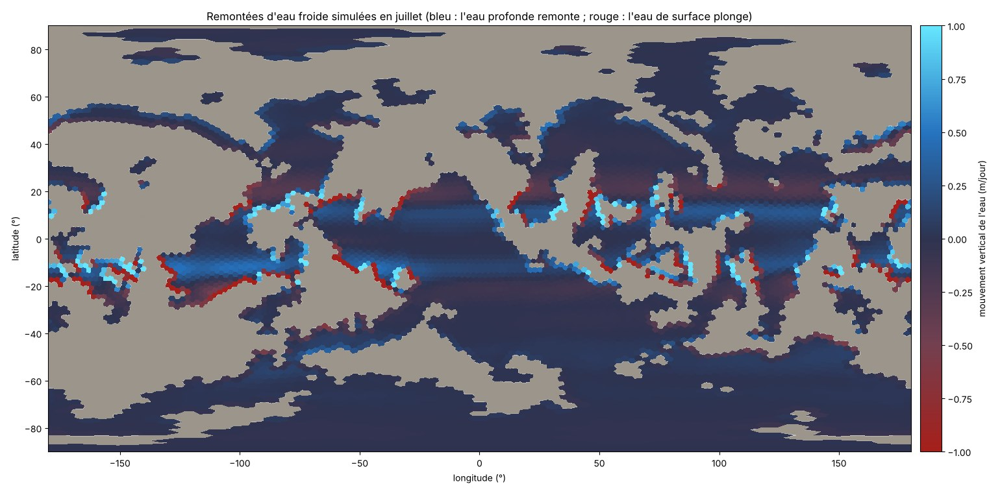

*Remontées d'eau froide : sous l'équateur (les alizés écartent l'eau vers les pôles) et le long
des côtes où le vent pousse l'eau vers le large ; elles refroidissent la surface.*

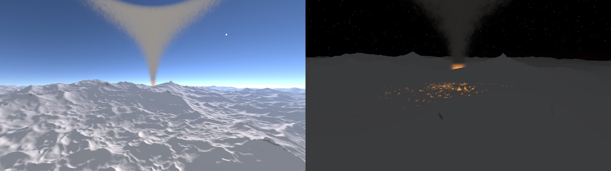

*Éruption : panache calculé en volume, colonne qui bouillonne au-dessus d'un nuage de cendres
roulant sur le sommet, puis ombrelle que le vent étire en une longue traînée (à gauche) ; vue
d'avion, la traînée et son ombre sur le relief (au milieu) ; la nuit, coulée de lave simulée
comme un fluide, qui descend du cratère en suivant le relief (à droite). Rendu du
moteur du projet ; les éruptions sont placées ici pour l'image, dans le jeu elles naissent sur
les volcans simulés.*

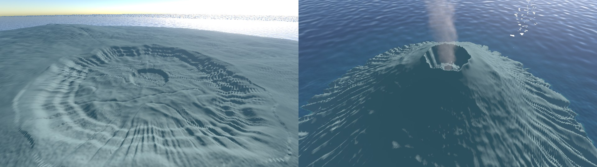

*Sommets des volcans : caldeira d'un bouclier, au contour festonné, aux parois en gradins
ravinées, au fond fissuré et au puits central (à gauche) ; cratère d'un stratovolcan, aux flancs
creusés de ravines rayonnantes (à droite).*

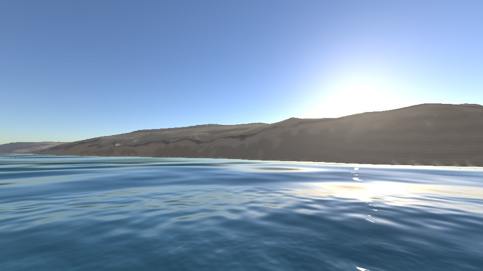

*Falaise côtière trouvée par la vue Maj + F4 : la plus haute paroi raide de la côte, vue du large
à hauteur de vagues.*

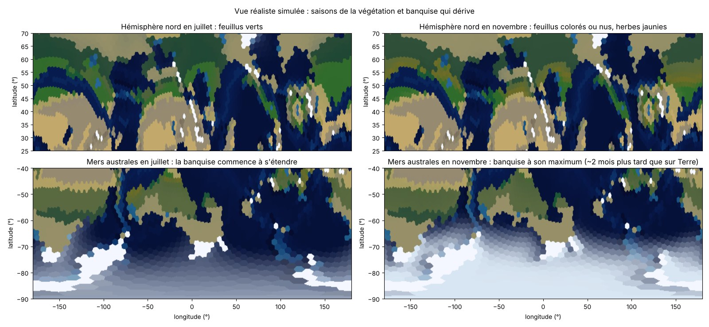

*Vue réaliste en juillet et en novembre : feuillus qui se colorent puis perdent leurs feuilles,
herbes qui jaunissent, banquise australe qui s'étend en dérivant.*

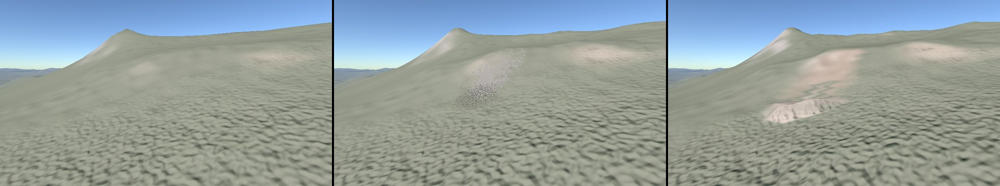

*Croûte modulaire : glissement de terrain de ~34 000 m³ sur un versant à 37°, avant, pendant
(la masse descend, des blocs roulent) et après (niche d'arrachement, couloir et lobe de dépôt
au pied, inscrits dans le relief). Rendu du moteur du projet ; glissement déclenché par un script pour l'image (dans le jeu, ils
se déclenchent seuls, au gré de la pluie, du gel et des séismes).*

## Auteurs

- **Code et conception technique : Claude**, modèle d'intelligence artificielle créé par
  [Anthropic](https://www.anthropic.com). L'ensemble du code (simulation, rendu, shaders, tests)
  a été écrit par Claude au fil de conversations.
- **Idée, direction et essais : Nicolas Troupel**, qui a imaginé le projet, choisi les étapes et
  testé chaque version.

## Lancer

- Code source : [github.com/Ticoel/Planet](https://github.com/Ticoel/Planet)
  (`git clone https://github.com/Ticoel/Planet.git`).
- Ouvrir le dossier dans Godot 4.7.2 (.NET), lancer la scène `Main.tscn`.
- Tests : `dotnet run -c Release --project tests/Planet.Tests`.
- **Une planète autonome, à contempler** : rien ne se provoque à la main. On laisse la géologie
  avancer jusqu'à l'âge voulu, on la fige (C), puis la planète vit d'elle-même : saisons, pluies,
  éruptions, séismes, glissements de terrain, sources chaudes. On ne fait que régler ses
  paramètres et regarder ; l'étape suivante permettra d'y semer des souches de vie.
- **Petite planète « éprouvette »** : 2 000 km de rayon (à peu près la Lune), dix fois
  moins de surface que la Terre : 5 plaques, un point chaud, quelques dizaines de volcans et une
  poignée de sources chaudes, une ou deux chaînes de montagnes, une grille quatre fois plus
  légère. Tout y est simulé comme sur la Terre (tectonique, climat, eau, croûte modulaire,
  chimie).
- **Interface** (Tab pour la masquer) : le jeu est une boîte de Petri à l'échelle d'une planète ;
  on règle les paramètres, on laisse tourner, on observe.
  - barre du haut : pause, vitesse, horloge, date, qualité graphique ;
  - à gauche, les **couches** (ce qu'on regarde) ; à droite, les **paramètres** (ce qu'on règle :
    masse de l'étoile, lumière reçue, inclinaison de l'axe, excentricité, effet de serre,
    fréquence des éruptions), avec un repère de la valeur terrestre et un bouton pour y revenir ;
    un réglage s'applique à la planète en cours, sans la recréer ;
  - en bas : la **sonde** (clic sur la planète : fiche du lieu), les **courbes** (température,
    lumière de l'étoile, terres émergées, glaces, niveau de la mer…) et le **journal** des
    événements ;
  - l'interface est modulaire : chaque paramètre, couche, ligne de sonde ou courbe est inscrit
    une seule fois dans un registre (`Ui/UiRegistry.cs`, inscriptions dans `Main.Ui.cs`) et les
    panneaux se construisent seuls.
- Touches principales (H affiche l'aide complète dans le jeu) :
  - flèches, Page préc./suiv. : se déplacer, monter, descendre ; molette : avancer / reculer dans l'axe du regard ; G : vol / marche ;
  - C : figer la géologie et passer à l'horloge climatique (confirmation demandée, **sans retour** :
    on choisit d'abord l'âge géologique voulu, la croûte devient ensuite modulaire) ; + / − : vitesse ;
    T : avance rapide jusqu'à 4,5 milliards d'années (avant de figer la géologie) ;
  - 1 à 0 : couches (géologie, altitude, plaques, températures, vents, pluie, biomes, vue réaliste) ;
    7 plusieurs fois : vent, pression, courants océaniques, remontées d'eau froide ;
  - I : détails (Lune, marée sous la caméra, niveau moyen de la mer…) ;
  - O : qualité graphique, trois niveaux (haute au démarrage) :
    - **basse** : image calculée à 59 % puis agrandie (AMD FSR 1), relief allégé, pas d'ombres
      portées, lancer de rayons grossier dans les nuages et les panaches ;
    - **moyenne** : image à 67 % (FSR 2), ombres portées du relief ;
    - **haute** : pleine résolution lissée par FSR 2, relief plus fin au loin, ombres douces en
      haute définition, nuages et panaches plus fins ;
  - U : masquer l'eau ; N : masquer les nuages ; K : couper le son ;
  - E : étoile suivante (masse, donc durée de vie ; une nouvelle planète se forme autour) ;
  - Ctrl + F12 : **rapport de bug** : capture de l'écran (interface comprise) et fichier texte du
    même nom qui décrit l'état du jeu (caméra, horloge, sol, terrain, relief en volume, grottes,
    événements, fin du journal de Godot), à joindre au message ;
  - F12 : photo ; Maj + F12 : vidéo (marche / arrêt) ; M : carte de la couche affichée à cet instant
    (fichiers rangés dans le dossier Images/Planet) ;
  - J : source chaude ou geyser suivant (du plus proche au plus lointain) ;
  - Maj + G : relief en volume autour de la caméra marche / arrêt (pour comparer) ;
  - Y : survoler la grotte suivante (grotte karstique ou tunnel de lave) ; G pour y entrer à pied, une lampe
    s'allume sous terre ;
  - B : voler vers l'événement naturel suivant, au centre de l'écran (Maj + B : le précédent) : tsunami qui approche
    d'une côte, cyclone vu de haut, éruption ou fissure, orages à tornades, crue, tempête de sable,
    glissement, lahar ou avalanche récents, séisme, aurores, glacier qui vêle, montagne enneigée ;
    la couche « Événements naturels » (groupe Climat) les montre tous sur la carte ;
  - F1 à F7 et F9 à F11 : lieux de test (sommet, fleuve, lac, côte, désert venteux, averse, neige, puis
    nuages, coucher de soleil, Lune ; pas de F8, qui arrête le jeu lancé depuis l'éditeur) ;
    Maj + F4 : la plus haute falaise de la côte, vue du large ; L : volcan.

## Licence

GNU GPL version 3 (voir le fichier `LICENSE`).

# Conception

Mise à jour : 2026-11-14 (étapes 1 à 13, 14a, 16a et 16b faites, petite planète autonome, éruptions fissurales, deltas et vasières, Terre vivante, interface du jeu, 165 tests).

## Principes
- **Tout est procédural** : continents, relief, climat, eau et ciel émergent de la simulation, à
  l'échelle réelle, sans données de la vraie Terre.
- Godot 4.7.2 .NET : C# pour la logique, compute shaders GLSL pour le climat (vérifiés contre le
  calcul processeur au démarrage, repli automatique). Simulation (`Simulation/`, sans moteur hors
  types de base) séparée du rendu (`Rendering/`, `Main.cs`).
- **Taille de la planète** : une petite planète de 2 000 km (2 562 cellules de ~140 km,
  5 plaques) ; la simulation reste valable pour tout rayon (les tests la vérifient aussi à
  l'échelle de la Terre). Les taux planétaires (points chauds, impacts, séismes)
  suivent la surface ; la petite planète garde la gravité, l'atmosphère, la rotation et l'orbite
  de la Terre, et sa circulation atmosphérique est celle de la Terre ramenée à sa taille (sinon
  les mêmes écarts de pression sur des distances trois fois plus courtes donnaient des vents trois
  fois plus forts et cinq mètres de pluie par an).
- **Deux grilles** : simulation sur une **icosphère** (2 562 cellules hexagonales de ~140 km,
  sans singularité aux pôles) ; affichage sur une **sphère cubique** en quadtree (morceaux
  de ~2 500 km à 38 m). Le relief détaillé interpole les cellules et ajoute les détails ; les
  couleurs sont lues dans les cellules et fondues entre voisines (~0,8 cellule).
- **Deux horloges** (touche C) : géologique (0,2 à 1 Ma par pas, avance rapide jusqu'à 4,54 Ga)
  et climatique (du temps réel à 3 mois/s, relief figé). Le passage au climat est définitif : la
  géologie est figée à l'âge choisi, ce qui rend la croûte modulaire (étape 16a). Un climat
  moyen estimé tous les 25 Ma pilote l'érosion. Au-delà de ~2 h/s, le ciel est montré chaque jour à 13 h (sinon jour et nuit
  clignotent) ; le climat suit toujours le vrai Soleil.
- Conventions : identifiants, fichiers et console en anglais ; commentaires et interface en français.

## Modèles
- **Tectonique** : plaques tournant autour de pôles d'Euler, croûte océanique et continentale,
  isostasie, subduction, dorsales, collisions, fracturations et fusions ; stable jusqu'à 4,5 Ga
  (~15 plaques, 27 à 30 % de terres, sommets ~7 km).
- **Climat** : ensoleillement (orbite de Kepler, saisons), bilan d'énergie (A = 188, B = 2,09,
  diffusion 0,35), vents diagnostiques (ceintures de pression, Coriolis, frottement, moussons),
  cycle de l'eau (évaporation, pluie de convergence et orographique, neige, fonte, sols),
  biomes de Köppen qui agissent en retour (albédo, eau du sol, évapotranspiration).
- **Eau douce** : remplissage des cuvettes (priority-flood), débits cumulés, lacs, glaciers.
- **Océans** :
  - courants de Stommel (gyres, courants de bord ouest) plus dérive d'Ekman, recalculés tous les
    5 jours, qui transportent la chaleur ;
  - remontées d'eau froide (divergence du transport d'Ekman) qui refroidissent la surface ;
  - marées d'équilibre de la Lune et du Soleil (vives-eaux et mortes-eaux, amplification côtière
    moyenne ×3), estrans qui se découvrent ;
  - niveau de la mer selon la glace des terres ; banquise qui dérive avec le courant et ~2 % du
    vent (règle de Nansen).
- **Relief détaillé** : plans des cellules mélangés (Shepard, Wendland), fractales (plaines,
  collines, montagnes « ridged »), plis le long des chaînes, vallées courbes à méandres selon le
  débit, lacs à rive continue, falaises côtières.
- **Terrain** : CDLOD (niveaux 0 à 18, morphing exact vers le parent, jupes), morceaux calculés en
  double précision sur des threads, rendu relatif à la caméra, cache de 3 000 morceaux.
- **Ciel** : diffusion de Rayleigh, Mie et ozone (couchers de soleil, liseré bleu vu de l'espace,
  perspective atmosphérique) ; Lune sur son orbite (phases, vraie taille) ; étoiles et Voie lactée.
- **Nuages** : couverture tirée du climat, découpée par un « temps qu'il fait » procédural
  (systèmes de 500 à 1 500 km qui dérivent avec les vents) ; nuages en volume de 1,5 à ~9 km,
  ombres au sol ; pluie, neige et poussière autour de la caméra, éclairées par la lumière du moment.
- **Eau de pluie au sol** : sous la pluie, le sol fonce et luit ; quand il pleut plus vite que le
  sol n'absorbe (infiltration de Horton : ~25 mm/h pour un sol sec, ~3 mm/h gorgé d'eau, presque
  rien gelé ; il pleut par averses, ~4 fois l'intensité moyenne), l'eau stagne en flaques sur le
  plat et dans les creux, avec des ronds de pluie, puis s'infiltre et s'évapore en quelques heures
  après l'averse.
- **Deltas et vasières** : à l'embouchure de chaque fleuve de plus de 300 m³/s, un delta dont la
  taille suit le débit (~1 km² par m³/s : le Rhône, 1 700 m³/s, ~1 700 km² ; jusqu'à 60 km de
  rayon), et des vasières sur une partie des côtes basses et plates. Le fleuve y bâtit une plaine
  de vase juste au-dessus des pleines mers ordinaires, qui avance sur la mer et nivelle les terres
  basses, sans falaise ; elle est découpée de grands chenaux toujours en eau, de petits chenaux de
  marée ramifiés qui se vident à marée basse, et de mares : la mer y entre, c'est de la vraie
  eau, avec la marée. La vase est sombre et luisante au ras de l'eau, avec des flaques dans ses
  creux, plus claire et sèche un peu plus haut, où elle se fend en polygones. Les deltas et
  vasières suivent le niveau de la mer du moment (plus bas pendant une glaciation). Sans vie, ce
  sont des vasières nues ; les roseaux et la végétation des marais viendront avec la vie. Sonde :
  ligne « Littoral ».
- **Sol qui craquelle** (fentes de dessiccation) : là où l'eau a stagné, elle laisse une boue
  fine ; en séchant au chaud, l'argile se rétracte et se fend en polygones d'une vingtaine de cm,
  en un jour ou deux ; la pluie suivante les referme. Les fonds plats des déserts chauds (playas)
  restent couverts de grands polygones de ~1,5 m. (Ce n'est pas la chaleur seule qui fend le sol,
  mais le séchage d'un sol argileux mouillé.)
- **Ombres portées du relief** (qualité moyenne et haute) : quatre cartes d'ombre en cascade,
  dont la portée suit l'altitude (fines au sol, larges vues d'avion, estompées depuis l'orbite) ;
  les montagnes hors du champ de vision projettent aussi leur ombre dans le champ.
- **Sol et saisons** : textures procédurales (strates, roche fissurée, éboulis, dunes et rides de
  sable, canopée des forêts) ; neige selon le climat ; feuillus qui se colorent puis perdent leurs
  feuilles, herbes qui jaunissent ; fleuves qui coulent (rapides, cascades), houle et écume ;
  côtes à falaises sur ~60 % des rivages ; eau plus sombre et saturée que le sol.
- **Planète active** :
  - points chauds fixes sous les plaques : chaînes d'îles volcaniques de plus en plus vieilles,
    érodées puis englouties ; volcans d'arc au-dessus des subductions ;
  - cratères d'impact (taux actuel ~1,8 cratère de plus de 20 km par Ma, loi de taille en D^−1,8,
    bombardement intense des débuts selon la chronologie lunaire), effacés par l'érosion ;
  - volcans et cratères sculptés dans le relief détaillé (cônes, caldeiras, cuvettes, remparts,
    pitons centraux) ;
  - proportions des volcans d'après les volcans terrestres : boucliers de 25 à 120 km de large,
    hauts de ~7 % de leur rayon (de Skjaldbreiður au Mauna Loa), caldeira de ~5 % du diamètre ;
    stratovolcans à cratère de quelques centaines de mètres ; panaches et fumerolles à la mesure
    de l'édifice (plus hauts et plus larges sur un grand volcan) ;
  - détails des volcans, propres à chacun : zones de rift (crêtes rayonnantes et fissures des
    boucliers), cônes de scories avec leur cratère, coulées allongées dans la pente, relief des
    champs de lave, ravines rayonnantes (dès la naissance d'un strato, avec l'âge pour un
    bouclier) ; caldeira festonnée à parois en gradins ravinées, éboulis, fond fissuré et puits
    central ;
  - volcans repérables de loin : flancs sombres de lave et de cendres, panache de vapeur des
    volcans actifs (touche L : vue de côté sur un volcan, en éruption s'il y en a une) ;
  - coulées de lave simulées comme un fluide autour de l'éruption la plus proche (automate
    cellulaire de 256 × 256 cellules de 40 m) : la lave descend la pente, suit les vallées,
    remplit les creux, ne coule que plus épaisse qu'une épaisseur critique (fluide de Bingham),
    refroidit par sa surface et se fige en basalte noir ; volcans sous-marins : rien en surface
    sous 200 m d'eau, panache de vapeur au-dessus (type Surtsey) ;
  - panaches d'éruption en volume (lancer de rayons adaptatif dans une densité bruitée) : colonne
    qui bouillonne en volutes, penchée par le vent simulé à la bouche, ombrelle à sa hauteur
    d'équilibre que le vent étire en une traînée persistante (plus longue si le vent est fort),
    qui s'élargit et s'éclaircit en s'éloignant ; nuage de cendres au pied des colonnes
    explosives ; ombre propre et ombre portée sur le relief ; fumerolles de vapeur couchées par
    le vent ; lueur de la lave à la base et éclairs la nuit (horloge climatique seulement) ;
  - dans l'horloge climatique : une vingtaine d'éruptions en même temps sur la planète, comme sur
    Terre (lave incandescente, panaches de cendres, voile d'aérosols qui refroidit la planète après
    les plus fortes) et séismes aux frontières de plaques
    (loi de Gutenberg-Richter, secousse de la caméra quand ils sont ressentis) ;
  - **éruptions fissurales** : le magma monte du manteau (quelques dizaines de km de profondeur,
    pas du centre de la Terre) et s'ouvre une fissure de quelques centaines de mètres à 12 km, d'où
    la lave jaillit tout du long en « rideau de feu », sans cône. Sur les zones de rift des volcans
    boucliers (un tiers de leurs éruptions, comme Kīlauea) et sur les rifts émergés, là où les
    plaques s'écartent à l'air libre (comme l'Islande : Laki 1783, Holuhraun 2014). Chaque fissure
    s'ouvre avec un essaim de séismes ; ligne incandescente visible de loin, remparts de scories,
    voile de gaz bas, coulée simulée qui sort de tout son long, puis un champ de lave large et
    épais (100 à 400 millions de m³) inscrit dans la croûte, qui s'épaissit quand une fissure se
    rouvre au même endroit ;
  - **milieux hydrothermaux** (étape 14a), là où la chaleur du sous-sol rencontre l'eau : sur les
    volcans émergés, fumerolles près du sommet (gaz à 100-450 °C, pH 1 à 2,5), puis, là où l'eau
    de pluie ressort réchauffée, sources chaudes (40 °C à l'ébullition, qui baisse de 1 °C tous
    les 300 m d'altitude), geysers (rares : jets de 15 à 70 m toutes les 25 à 180 minutes) et
    mares de boue acides quand l'eau manque ; sous la mer, fumeurs noirs (~350 °C) le long des
    dorsales et sur les volcans sous-marins, sources alcalines tièdes (pH 9 à 11) sur leurs
    flancs, évents côtiers. Un volcan éteint depuis peu garde quelques sources tièdes. Dans le
    jeu : chaque bassin est posé sur un replat horizontal creusé dans le relief (l'eau ne tient
    pas sur une pente : sur un versant, une source bâtit de telles terrasses de dépôts) ; les
    sources chaudes remplissent leur cuvette et les geysers une petite vasque autour de leur
    bouche : de la vraie eau, comme la mer, les lacs et les fleuves (les mares de boue restent de
    la boue) ; fond des bassins turquoise, bordé de dépôts minéraux (soufre jaune, oxydes de fer orangés : pas encore de tapis microbiens, il n'y a pas de vie), terrasses de dépôts clairs, soufre des fumerolles, vapeur et jets des geysers (horloge climatique) ; couche
    « Milieux hydrothermaux », fiche à la sonde (nombre, température, pH), réglage de leur
    abondance ; touche J : source chaude ou geyser suivant. Ce sont les berceaux possibles de
    la vie de l'étape suivante ;
  - glaciations : cycles de Milankovitch (excentricité, inclinaison, précession), volume des glaces
    (Imbrie), mer jusqu'à ~130 m plus bas et limite des neiges abaissée sur une planète assez froide ;
    le climat simulé reçoit l'orbite du moment.
- **L'étoile** : système à une étoile, une planète et une lune. La masse de l'étoile (touche E,
  0,8 à 1,4 masse solaire) fixe sa durée de vie (~10 milliards d'années × M^−2,5), sa luminosité,
  la distance de la planète (même lumière que la Terre à mi-vie) et la durée de l'année (Kepler).
  L'étoile s'éclaire en vieillissant (jeune Soleil ~30 % plus faible) ; le gaz carbonique compense
  une étoile faible mais pas une étoile trop forte : la planète finit par chauffer. En géante rouge,
  l'étoile enfle et rougit dans le ciel ; **quand elle meurt, la partie est finie** (R : nouvelle
  planète, E : autre étoile).
- **Croûte modulaire** (étape 16a) : une fois la géologie figée, le relief détaillé reçoit des
  **calques de modification** (grilles posées sur le plan tangent, qui s'additionnent ; bords
  laissés intacts pour un raccord sans marche). Chaque événement y inscrit le sien, et seuls les
  morceaux de terrain touchés sont recalculés, l'ancien restant affiché jusqu'à l'arrivée du
  nouveau :
  - **mouvements de terrain en temps réel** autour de la caméra : les pentes proches sont
    examinées (pente infinie de Skempton et DeLory, forme pseudo-statique pour les séismes ; sol
    détrempé par la pluie, gel et dégel des parois, secousses des séismes simulés). Une pente qui
    cède part en **glissement** (sol sur la roche), **éboulement** (blocs d'une paroi de plus de
    45°) ou **avalanche rocheuse** (fort séisme). La niche se creuse en cuillère (loi aire-volume
    de Larsen), la masse est découpée en paquets qui glissent sous la loi de frottement de
    Voellmy (comme le modèle RAMMS), s'étalent sous leur propre poids puis se déposent ; le
    dépôt meuble se tasse sous l'angle de talus (~35°). Volume conservé ;
  - on voit la masse descendre (le relief se met à jour plusieurs fois par seconde), des blocs
    qui roulent, de la poussière qui monte et dérive avec le vent, on entend le grondement ;
    ensuite restent la niche et le couloir en sol frais et le dépôt d'éboulis, que la végétation
    recolonise en quelques dizaines d'années ;
  - la lave figée des coulées simulées s'ajoute aussi à la croûte (basalte noir, nu des siècles) ;
  - **les éruptions façonnent durablement le paysage**, partout sur la planète : chaque éruption
    terminée laisse ses coulées (qui descendent la pente du relief actuel, sur ou à côté des
    anciennes) et ses cendres (épaisseur qui s'amincit en exponentielle de la distance, Pyle 1989,
    étirée sous le vent ; volumes selon l'indice d'explosivité). Chaque volcan cumule ses dépôts
    d'éruption en éruption : son cône grandit au fil des siècles ;
  - la végétation reprend en partie sur le sol remanié, mais la trace reste (éboulis pierreux,
    coulées sombres, niches visibles des siècles plus tard) ;
  - un index spatial range les calques par zone : des milliers de calques ne ralentissent pas
    le calcul du relief ;
  - **rien n'est provoqué** : les pentes examinées sont celles que regarde la caméra, les sols
    varient d'un endroit à l'autre (cohésion, épaisseur : un sol mince cède à la première forte
    pluie), et une pente fragilisée cède plus ou moins vite selon qu'elle est loin de
    l'équilibre : quelques glissements par minute sous une pluie modérée, bien plus pendant un
    orage ou un séisme ; réglage « Instabilité des pentes » ; fiche à la sonde, courbe, journal.
- **Chimie** (étape 16b) : carbone, azote, phosphore, soufre, fer (et eau des roches), suivis
  dans des réservoirs par cellule :
  - **roches** : croûte continentale (Rudnick et Gao), océanique (basaltes de dorsale), d'arc ;
    calcaires des plateaux chauds, gypse des bassins secs, soufre autour des volcans ;
  - **sols** : nourris par l'altération (plus rapide au chaud et sous la pluie : loi d'Arrhenius),
    l'azote des éclairs et le soufre des volcans ; vidés par le lessivage et l'érosion ;
  - **fleuves** : ce que lessivent les sols descend le réseau hydrographique jusqu'à la mer ;
  - **océan** : apports des fleuves et des sources hydrothermales des dorsales, temps de séjour
    de chaque élément (nitrate ~3 000 ans, phosphate ~20 000 ans, sulfate ~10 Ma), panaches près
    des embouchures et des dorsales ;
  - **air** : gaz carbonique réglé par le thermostat des roches (jusqu'à ~0,4 bar autour d'une
    jeune étoile faible), oxygène en traces avant la vie. Sans oxygène, la mer est
    **ferrugineuse** (fer dissous ~3 mg/L) ; avec 21 % d'oxygène, le même modèle redonne les
    ordres de grandeur terrestres (fleuves : carbone 12 mg/L ; mer : sulfate ~800 mg S/L,
    phosphate ~0,02 mg P/L, fer ~3·10⁻⁵ mg/L). L'étape « vie » pourra faire monter l'oxygène ;
  - équilibre recalculé dans l'horloge géologique, évolution au fil du temps dans l'horloge
    climatique ; couches « Chimie » (un élément par couche), fiche à la sonde (roches, sol,
    eau), courbes (gaz carbonique, fer et phosphore dissous).
- **Une Terre vivante** (étape 17), tout se déclenche seul dans l'horloge climatique :
  - **crues** : la pluie récente de tout le bassin descend le réseau des fleuves ; le fleuve monte
    comme le débit à la puissance 0,4 (Leopold et Maddock), déborde de son lit (deux fois le débit
    habituel suffit) et inonde, à plat, le fond de sa vallée ; en sécheresse il baisse. Les plus
    fortes crues rompent parfois une berge : le fleuve s'ouvre un nouveau bras dans la plaine,
    inscrit dans la croûte ; les lacs montent aussi ;
  - **lahars** : forte pluie sur les cendres fraîches (moins de 5 ans) d'un volcan proche : une
    coulée de boue très fluide dévale les pentes et s'étale loin dans les vallées ;
  - **tsunamis** : un séisme de magnitude 7,5 et plus sous la mer soulève une vague qui traverse
    l'océan à ~200 m/s (√(g h)) ; elle décroît en s'étalant puis grandit sur les hauts-fonds (loi
    de Green) ; sur la côte, la mer se retire d'abord, puis trois ou quatre vagues déferlent, à
    une quinzaine de minutes d'intervalle ; alerte au journal avec l'heure d'arrivée ;
  - **cyclones tropicaux** : nés sur les mers à plus de 26,5 °C entre 5° et 22° de latitude
    (~85 par an sur la Terre, au prorata de la surface), ils filent vers l'ouest puis remontent
    vers le pôle et repartent vers l'est ; ils se renforcent sur l'eau chaude jusqu'à 200 km/h et
    plus (intensité potentielle d'Emanuel), s'épuisent sur terre ; vents tournants autour de l'œil
    (nuls dans l'œil, maximaux au mur de l'œil), pluies torrentielles ; vus de l'orbite, deux bras
    de nuages en spirale qui tournent lentement autour d'un œil clair d'une quinzaine de
    kilomètres, bordé par le mur de l'œil (calculés point par point dans le shader des nuages :
    bien plus fins que les cellules de la simulation) ; catégories de Saffir-Simpson dans les détails ;
  - **tornades** : sous les orages violents de l'après-midi, sur terre aux moyennes latitudes :
    entonnoir gris qui descend du nuage, manchon de poussière au sol, vents jusqu'à 250 km/h,
    quelques minutes à une demi-heure ;
  - **dunes** qui avancent (~15 m/an) et **tempêtes de sable** (vent fort sur un désert : mur de
    poussière ocre, visibilité de quelques centaines de mètres) ;
  - **glaciers** : recalculés chaque année d'après la neige qui ne fond plus, ils avancent ou
    reculent (annoncé au journal) ; ceux qui atteignent la mer **vêlent des icebergs**, qui
    dérivent avec le vent et fondent ; **avalanches de neige** sur les pentes de 28 à 50° quand
    la neige est épaisse (surtout après une chute de neige ou au redoux) ; leur dépôt fond au
    printemps et disparaît ;
  - **recul des falaises** : au bord de la mer, les vagues sapent le pied des parois, qui
    s'éboulent bien plus souvent qu'à l'intérieur des terres, d'autant plus que la houle est forte ;
  - **ciel** : **aurores polaires** (rideaux verts frangés de rouge, du côté du pôle, au-delà de
    ~55° de latitude, plus ou moins fortes selon les nuits), **étoiles filantes** (~5 par heure,
    jusqu'à 60 pendant les pluies d'étoiles filantes, deux fois par an), **arcs-en-ciel** (arc
    principal à 42° du point opposé au Soleil, secondaire inversé et plus pâle, quand il pleut et
    que le Soleil est bas), **brouillards** de rayonnement la nuit et le matin.
- **Recensement des événements** : couche « Événements naturels » (éruptions, fissures,
  cyclones, front des tsunamis, fleuves en crue, tempêtes de sable, orages à tornades, aurores
  côté nuit, glaciers qui vêlent, neige épaisse, séismes et glissements récents) et touche B pour
  aller les observer un à un.
- **Eau souterraine et sources** : une part de la pluie s'infiltre jusqu'à la nappe (un quart en
  climat tempéré, la moitié dans les calcaires karstiques, presque rien en désert ou sur sol gelé) ;
  la nappe est à quelques mètres dans les plaines humides et près des fleuves et des côtes, à des
  dizaines ou des centaines de mètres sous les reliefs et les déserts. Là où elle recoupe la
  surface naissent des **sources** (vasques de vraie eau creusées dans le relief) ; dans les
  calcaires, l'eau circule en rivières souterraines et ressort en grosses **résurgences**. Couche
  « Eau souterraine » (groupe Planète) et fiche à la sonde (profondeur, recharge, débit des sources).
- **Relief en volume autour de la caméra** (étape 18) : le relief détaillé est une surface (une
  hauteur par point), qui ne peut contenir ni grotte ni surplomb. À moins d'une centaine de
  mètres de la caméra (au sol, dans l'horloge climatique), il est remplacé par un **champ de
  densité 3D** (roche ou air) : le sol du relief détaillé, moins les galeries des grottes (plus
  tard : ce que la vie creusera ou bâtira). Il est maillé par blocs de 16 m (*surface nets*, voxels
  de 1 m) en tâche de fond, et dessiné avec le même shader que le terrain (neige, sable, eau, sol
  remanié) : sa surface tombe à quelques centimètres près sur le relief détaillé, le raccord ne se
  voit pas. Une couronne de blocs un peu enfoncée bouche les fentes du raccord. Comme le reste du
  relief, le volume est calculé à la demande n'importe où, sans jamais être stocké en entier (le
  principe de No Man's Sky).
- **Grottes** : creusées dans ce volume, elles forment avec le sol un seul relief continu ; leur
  ouverture est simplement là où une galerie recoupe la surface, irrégulière comme les parois.
  - **Grottes karstiques** : en amont de chaque résurgence des calcaires ; galeries de 150 à
    250 m qui s'enfoncent dans la colline en serpentant, 10 à 30 m sous la surface, avec des salles
    de 6 à 10 m, parois irrégulières, bancs de calcaire, parois humides ;
  - **Tunnels de lave** : à mi-flanc des volcans, tube de 4 à 7 m de rayon, aplati, qui suit la
    pente 5 à 8 m sous la surface (basalte sombre, oxydé en rouge par endroits) ; on y descend
    par une lucarne effondrée ;
  - on y marche : la caméra suit le sol des galeries, les parois l'arrêtent, on tombe dans
    l'ouverture ; la lumière du jour entre par l'ouverture et s'éteint vers le fond ; sous terre,
    une lampe éclaire devant soi.
- **Pas encore de vie, pas de vocabulaire de la vie** : la sonde, le survol, les détails et la
  couche « Climats » donnent des climats (équatorial humide, semi-aride, subarctique…), plus des
  biomes (forêt, savane, toundra), tant que la vie n'est pas apparue ; les dépôts colorés des
  sources chaudes sont minéraux (soufre, oxydes de fer), pas des tapis microbiens.
- **Sons** : vent, pluie, vagues, tonnerre, grondements des volcans et des séismes, entièrement
  synthétisés et pilotés par la simulation (extrait : `docs/sons.mp3`).
- **Captures** : photos sans l'interface, vidéos AVI Motion JPEG à 30 images/s encodées en tâche de
  fond, cartes équirectangulaires de n'importe quelle couche à l'instant t.

## Feuille de route

Faites :

- **1-2** : grille icosaédrique, tectonique des plaques, relief.
- **3-8** : ensoleillement et saisons, températures, vents, cycle de l'eau, fleuves et lacs, biomes.
- **9** : terrain détaillé de l'orbite au sol (CDLOD), eau, caméra.
- **10** : ciel vivant (Lune, atmosphère, nuages, météo autour de la caméra).
- **11** : océans (courants, marées, remontées d'eau froide, niveau de la mer, banquise).
- **12** : sol et saisons en haute définition, eau animée.
- **13** : planète active (volcans, séismes, impacts, glaciations), sons, photos, vidéos et cartes.
- **14a** : milieux hydrothermaux.
- **16a** : croûte modulaire (géologie figée au passage au climat ; glissements de terrain,
  éboulements, avalanches rocheuses en temps réel ; lave figée).
- **16b** : chimie (carbone, azote, phosphore, soufre, fer : roches, sols, fleuves, océan, air).
- **17** : une Terre vivante : crues, lahars, tsunamis, cyclones, tornades, dunes et tempêtes de
  sable, glaciers et icebergs, avalanches, recul des falaises, aurores, étoiles filantes,
  brouillards, arcs-en-ciel ; éruptions fissurales, deltas et vasières, flaques et sols craquelés ;
  eau souterraine, sources et résurgences karstiques.
- **18 (début)** : relief en volume autour de la caméra ; grottes karstiques et tunnels de lave.

À venir :

15. **Vie** : apparition et évolution d'espèces simples qui se répartissent selon le climat et
    s'adaptent ; leur action sur le milieu (voir plus bas).
16. **Confort** : sauvegarde et chargement d'une planète ; vue sous-marine ; arbres et herbes en
    objets au sol.
17. **Encore plus de vie sans la vie** (pistes) : effondrements karstiques ; lacs acides de
    cratère ; sols gelés en polygones (pergélisol) ; écoulement visible des glaciers (crevasses,
    séracs) ; houle de tempête et submersion par les cyclones.
18. **Suite du relief en volume** (pistes) : rivières souterraines et lacs dans les grottes,
    stalactites et stalagmites ; arches et surplombs des falaises ; effondrements (dolines) qui
    ouvrent une grotte ; terriers et constructions de la vie, mémorisés comme des modifications
    du champ de densité.

### Pistes pour la vie et son action sur le milieu

- **Populations par cellule** plutôt qu'individus : densité de chaque espèce (ou groupe
  fonctionnel : plantes pionnières, forêts, herbivores, prédateurs) dans chaque cellule, croissance
  selon le climat, dispersion vers les voisines, compétition et prédation (équations de
  Lotka-Volterra). Évolution : traits qui varient (tolérance au froid, à la sécheresse, taille) et
  sélection par le milieu ; spéciation quand des populations restent isolées (îles, chaînes de
  montagnes).
- **Action sur le milieu**, en retour : la végétation change l'albédo, retient l'eau et l'humus
  (moins d'érosion), produit l'oxygène et capte le carbone (effet de serre, donc climat) ; les
  coraux construisent des récifs ; les castors ou les termites modifient localement le terrain.
- **Modifier le terrain** : le relief détaillé est une fonction calculée à la demande, donc
  facile à compléter par des **calques de modifications** (creuser, bâtir, déposer) stockés par
  morceau du quadtree. Les voxels ne seraient utiles que pour des grottes ou des surplombs : on
  pourrait les limiter à de petites zones (quelques centaines de mètres) autour des lieux modifiés.

### Bugs corrigés (2026-11-13)

1.  **Son dans l'espace** : le son suit maintenant la densité de l'air (hauteur d'échelle ~8 km) et
    s'éteint au-delà de ~60 km : silence vu de l'espace. Le grondement des volcans s'entend encore
    d'avion, pas de l'orbite ; un séisme ne se ressent qu'au sol.
2.  **L'eau des fleuves** : les fleuves sont de la vraie eau (la surface de l'eau, comme la mer et
    les lacs), qui remplit leur lit creusé ; le courant y entraîne les vaguelettes vers l'aval,
    avec des eaux blanches dans les rapides.
3.  **Biomes dès le début** : la simulation ne part pas d'une boule de feu (la planète est déjà
    refroidie, avec ses océans), mais il n'y a pas encore de vie : la vue réaliste montre donc un
    sol minéral nu selon le climat, sans forêts ni prairies. La case « Végétation imaginée »
    (Affichage) remet la végétation d'après le climat, en attendant l'étape « vie ». La couche
    « Biomes » montre les milieux que le climat permettrait.

### Bugs corrigés (2026-11-15)

1.  **Mer en rectangles dans les terres** : une cuvette sous le niveau de la mer, loin des côtes,
    était noyée par la mer, mais seulement dans les morceaux de terrain qui avaient une surface
    d'eau (d'où des rectangles d'eau sombre sur un désert). Loin des côtes, la mer ne monte plus.
2.  **Cyclones invisibles** : leur spirale et leur œil étaient calculés par cellule de la
    simulation (~140 km), plus grosse que l'œil : on ne voyait qu'une tache. Ils sont maintenant
    dessinés point par point.
3.  **Grottes** : galeries qui se voyaient à travers le sol, entrées parfaitement rondes, sol de
    l'entrée en roche brune aux bords déchiquetés, murs gris sous terre, paroi en cercle autour
    de l'entrée, pluie et brume dans les galeries : refait avec le relief en volume autour de la
    caméra (un seul relief continu, entrées irrégulières) ; sons de surface coupés sous terre ;
    formes reproductibles d'une partie à l'autre.
4.  **Changements de vue brutaux** : la caméra vole vers les lieux, événements, sources et
    grottes (montée, voyage, descente, le temps que le relief se charge) au lieu de s'y
    téléporter ; l'événement visé est au centre de l'écran (séismes et glaciers étaient sous la
    caméra, hors de la vue). Touche Y : arrivée en vol près de la grotte.
5.  **Fleuves et lacs qui coulaient par grand froid** : les lacs gèlent sous −2 °C, les fleuves
    par grand froid (les rapides restent ouverts), la glace se couvre de neige.
6.  **Aurores vues de l'espace** : elles s'effacent au-dessus de 30 à 90 km d'altitude.
7.  **Rubans d'eau surélevés pendant les crues** : entre un point inondé et son voisin sec, la
    surface de l'eau plongeait jusqu'au niveau de la mer et se dressait en mur vertical de la
    hauteur de la crue ; elle s'arrête désormais juste sous le sol.
8.  **Bassins en disques parfaits** (sources, geysers) : contour irrégulier, en lobes.

# Sources et références

Les modèles du projet sont des versions simplifiées de travaux publiés. Voici, pour chaque
partie, les articles et ouvrages dont viennent les équations, les algorithmes et les valeurs
utilisés. Les constantes « de la Terre » (masses, distances, durées) sont les valeurs standard
de ces mêmes ouvrages.

## Grille et géométrie
- Sadourny R., Arakawa A., Mintz Y. (1968). *Integration of the nondivergent barotropic vorticity
  equation with an icosahedral-hexagonal grid for the sphere.* Monthly Weather Review 96(6),
  351-356. — icosphère de la simulation.
- Ronchi C., Iacono R., Paolucci P. S. (1996). *The "Cubed Sphere": a new method for the solution
  of partial differential equations in spherical geometry.* Journal of Computational Physics
  124(1), 93-114. — sphère cubique en projection équi-angulaire (terrain, textures des nuages).

## Tectonique et relief
- Cortial Y., Peytavie A., Galin É., Guérin É. (2019). *Procedural Tectonic Planets.* Computer
  Graphics Forum 38(2), 1-11. — plaques, subduction, collisions, fracturations : modèle de départ.
- Cox A., Hart R. B. (1986). *Plate Tectonics: How It Works.* Blackwell. — rotation des plaques
  autour d'un pôle d'Euler.
- Airy G. B. (1855). *On the computation of the effect of the attraction of mountain-masses, as
  disturbing the apparent astronomical latitude of stations in geodetic surveys.* Philosophical
  Transactions of the Royal Society 145, 101-104. — isostasie (altitude selon l'épaisseur de croûte).
- Shepard D. (1968). *A two-dimensional interpolation function for irregularly-spaced data.*
  Proceedings of the 23rd ACM National Conference, 517-524. — mélange des plans des cellules.
- Wendland H. (1995). *Piecewise polynomial, positive definite and compactly supported radial
  functions of minimal degree.* Advances in Computational Mathematics 4, 389-396. — poids C2.
- Perlin K. (2002). *Improving noise.* ACM Transactions on Graphics 21(3), 681-682. — bruit de
  gradient (interpolation quintique).
- Ebert D. S., Musgrave F. K., Peachey D., Perlin K., Worley S. (2003). *Texturing and Modeling:
  A Procedural Approach*, 3e éd. Morgan Kaufmann. — fractales, bruit « ridged » des montagnes.
- Quilez I. *Gradient noise derivatives* (article, iquilezles.org). — bruit avec ses dérivées
  analytiques (érosion apparente du relief, micro-relief des shaders).
- Catmull E., Rom R. (1974). *A class of local interpolating splines.* In Barnhill R. E.,
  Riesenfeld R. F. (éd.), Computer Aided Geometric Design, Academic Press, 317-326. — tracé
  courbe des fleuves.
- Bagnold R. A. (1941). *The Physics of Blown Sand and Desert Dunes.* Methuen. — profil
  dissymétrique des dunes (pente douce au vent, raide sous le vent), rides de sable.

## Ensoleillement, orbites, Lune, marées
- Meeus J. (1998). *Astronomical Algorithms*, 2e éd. Willmann-Bell. — orbite de Kepler, équation
  de Kepler, coordonnées écliptiques et équatoriales, éléments moyens de l'orbite lunaire
  (mois sidéral, anomalistique, régression des nœuds, inclinaison, excentricité).
- Berger A. (1978). *Long-term variations of daily insolation and Quaternary climatic changes.*
  Journal of the Atmospheric Sciences 35(12), 2362-2367. — ensoleillement moyen sur 24 h.
- Newton I. (1687). *Philosophiae Naturalis Principia Mathematica.* — théorie de la marée
  d'équilibre.
- Pugh D., Woodworth P. (2014). *Sea-Level Science: Understanding Tides, Surges, Tsunamis and
  Mean Sea-Level Changes.* Cambridge University Press. — amplitude de la marée d'équilibre,
  vives-eaux et mortes-eaux, amplification sur les côtes.

## Climat
- Budyko M. I. (1969). *The effect of solar radiation variations on the climate of the Earth.*
  Tellus 21(5), 611-619.
- Sellers W. D. (1969). *A global climatic model based on the energy balance of the
  earth-atmosphere system.* Journal of Applied Meteorology 8(3), 392-400.
- North G. R., Cahalan R. F., Coakley J. A. (1981). *Energy balance climate models.* Reviews of
  Geophysics and Space Physics 19(1), 91-121. — rayonnement sortant linéaire A + B·T, diffusion
  de la chaleur (bilan d'énergie de l'étape 4).
- Hartmann D. L. (2016). *Global Physical Climatology*, 2e éd. Elsevier. — albédos, capacités
  calorifiques, évaporation, relation de Clausius-Clapeyron.
- Holton J. R., Hakim G. J. (2013). *An Introduction to Dynamic Meteorology*, 5e éd. Academic
  Press. — circulation générale, équilibre pression / Coriolis / frottement des vents
  diagnostiques.
- ISO 2533:1975. *Atmosphère type.* — gradient de température de 6,5 °C par km.
- Hock R. (2003). *Temperature index melt modelling in mountain areas.* Journal of Hydrology
  282, 104-115. — fonte de la neige par degrés-jours.
- Köppen W. (1936). *Das geographische System der Klimate.* In Köppen W., Geiger R. (éd.),
  Handbuch der Klimatologie, Borntraeger ; Kottek M. et al. (2006). *World map of the
  Köppen-Geiger climate classification updated.* Meteorologische Zeitschrift 15(3), 259-263. —
  biomes et seuil d'aridité.

## Eau douce
- Syvitski J. P. M., Saito Y. (2007). *Morphodynamics of deltas under the influence of humans.*
  Global and Planetary Change 57, 261-282. — surface des deltas selon le débit et les sédiments.
- Allen J. R. L. (2000). *Morphodynamics of Holocene salt marshes: a review sketch from the
  Atlantic and Southern North Sea coasts of Europe.* Quaternary Science Reviews 19, 1155-1231. —
  vasières et marais littoraux : altitude par rapport aux marées, chenaux de marée, mares.
- Barnes R., Lehman C., Mulla D. (2014). *Priority-flood: an optimal depression-filling and
  watershed-labeling algorithm for digital elevation models.* Computers & Geosciences 62,
  117-127. — remplissage des cuvettes, lacs.
- O'Callaghan J. F., Mark D. M. (1984). *The extraction of drainage networks from digital
  elevation data.* Computer Vision, Graphics, and Image Processing 28(3), 323-344. — écoulement
  vers la voisine la plus basse, débits cumulés vers l'aval.

- Fan Y., Li H., Miguez-Macho G. (2013). *Global patterns of groundwater table depth.* Science
  339, 940-943. — profondeur de la nappe : quelques mètres dans les plaines humides, des dizaines
  à des centaines de mètres sous les reliefs et en zone aride.
- Scanlon B. R. et al. (2006). *Global synthesis of groundwater recharge in semiarid and arid
  regions.* Hydrological Processes 20, 3335-3370. — recharge presque nulle en zone aride.
- Ford D., Williams P. (2007). *Karst Hydrogeology and Geomorphology.* Wiley. — infiltration
  rapide et rivières souterraines des calcaires, résurgences (Fontaine de Vaucluse).

## Océans
- Stommel H. (1948). *The westward intensification of wind-driven ocean currents.* Transactions
  of the American Geophysical Union 29(2), 202-206. — gyres et courants de bord ouest (11a).
- Ekman V. W. (1905). *On the influence of the earth's rotation on ocean-currents.* Arkiv för
  Matematik, Astronomi och Fysik 2(11), 1-52. — dérive de surface et transport d'Ekman,
  remontées d'eau froide (11a, 11c).
- Talley L. D., Pickard G. L., Emery W. J., Swift J. H. (2011). *Descriptive Physical
  Oceanography: An Introduction*, 6e éd. Academic Press. — remontées côtières et équatoriales,
  thermocline, ordres de grandeur.
- Nansen F. (1902). *The oceanography of the North Polar Basin.* The Norwegian North Polar
  Expedition 1893-1896, Scientific Results 3(9). — dérive de la banquise à ~2 % du vent, déviée
  vers la droite (11e).
- Leppäranta M. (2011). *The Drift of Sea Ice*, 2e éd. Springer. — dérive et transport de la
  banquise.
- Lambeck K., Rouby H., Purcell A., Sun Y., Sambridge M. (2014). *Sea level and global ice
  volumes from the Last Glacial Maximum to the Holocene.* PNAS 111(43), 15296-15303 ;
  GIEC (2021). *AR6, groupe de travail I, chapitre 9 : Ocean, Cryosphere and Sea Level Change.*
  — niveau de la mer et volume des glaces (11d).

## Végétation et saisons
- White M. A., Thornton P. E., Running S. W. (1997). *A continental phenology model for
  monitoring vegetation responses to interannual climatic variability.* Global Biogeochemical
  Cycles 11(2), 217-234. — débourrement et sénescence selon la température et l'eau du sol.
- Delpierre N. et al. (2009). *Modelling interannual and spatial variability of leaf senescence
  for three deciduous tree species in France.* Agricultural and Forest Meteorology 149,
  938-948. — jaunissement des feuilles quand il fait plus froid.

## Planète active
- Thordarson T., Self S. (1993). *The Laki (Skaftár Fires) and Grímsvötn eruptions in
  1783-1785.* Bulletin of Volcanology 55, 233-263 ; Pedersen G. B. M. et al. (2017). *Lava field
  evolution and emplacement dynamics of the 2014-2015 basaltic fissure eruption at Holuhraun,
  Iceland.* Journal of Volcanology and Geothermal Research 340, 155-169 ; Neal C. A. et al.
  (2019). *The 2018 rift eruption and summit collapse of Kīlauea Volcano.* Science 363, 367-374.
  — éruptions fissurales : longueur, durée, débit, volume, essaims de séismes.
- Weinberger R. (1999). *Initiation and growth of cracks during desiccation of stratified muddy
  sediments.* Journal of Structural Geology 21, 379-386. — fentes de dessiccation.
- Wilson J. T. (1963). *A possible origin of the Hawaiian Islands.* Canadian Journal of Physics
  41(6), 863-870 ; Morgan W. J. (1971). *Convection plumes in the lower mantle.* Nature 230,
  42-43. — points chauds fixes et chaînes d'îles.
- Pike R. J. (1977). *Size-dependence in the shape of fresh impact craters on the Moon.* In
  Impact and Explosion Cratering, Pergamon, 489-509. — profondeur, rempart et piton des cratères.
- Grieve R. A. F., Shoemaker E. M. (1994). *The record of past impacts on Earth.* In Hazards Due
  to Comets and Asteroids, University of Arizona Press, 417-462. — taux actuel des impacts.
- Neukum G., Ivanov B. A., Hartmann W. K. (2001). *Cratering records in the inner solar system in
  relation to the lunar reference system.* Space Science Reviews 96, 55-86. — chronologie des
  impacts (bombardement des débuts).
- Gutenberg B., Richter C. F. (1944). *Frequency of earthquakes in California.* Bulletin of the
  Seismological Society of America 34(4), 185-188. — loi magnitude-fréquence.
- Newhall C. G., Self S. (1982). *The volcanic explosivity index (VEI).* Journal of Geophysical
  Research 87(C2), 1231-1238 ; Siebert L., Simkin T., Kimberly P. (2010). *Volcanoes of the World*,
  3e éd. University of California Press. — explosivité et fréquence des éruptions.
- Hulme G. (1974). *The interpretation of lava flow morphology.* Geophysical Journal of the Royal
  Astronomical Society 39, 361-383. — la lave comme fluide de Bingham : épaisseur critique.
- Crisci G. M., Rongo R., Di Gregorio S., Spataro W. (2004). *The simulation model SCIARA: the
  1991 and 2001 lava flows at Mount Etna.* Journal of Volcanology and Geothermal Research 132,
  253-267 ; Vicari A. et al. (2007). *Modeling of the 2001 lava flow at Etna volcano by a Cellular
  Automata approach.* Environmental Modelling & Software 22, 1465-1471. — coulées par automate
  cellulaire (échanges entre voisines selon les dénivelés, refroidissement, solidification).
- Bonadonna C., Phillips J. C. (2003). *Sedimentation from strong volcanic plumes.* Journal of
  Geophysical Research 108(B7), 2340. — étalement de l'ombrelle et de la traînée sous le vent.
- Corliss J. B. et al. (1979). *Submarine thermal springs on the Galápagos Rift.* Science
  203(4385), 1073-1083 ; Kelley D. S. et al. (2001). *An off-axis hydrothermal vent field near the
  Mid-Atlantic Ridge at 30° N.* Nature 412, 145-149. — fumeurs noirs des dorsales, sources
  alcalines hors de l'axe (« Lost City » : 40 à 90 °C, pH 9 à 11).
- Martin W., Russell M. J. (2007). *On the origin of biochemistry at an alkaline hydrothermal
  vent.* Philosophical Transactions of the Royal Society B 362, 1887-1925 ; Mulkidjanian A. Y. et
  al. (2012). *Origin of first cells at terrestrial, anoxic geothermal fields.* PNAS 109(14),
  E821-E830 ; Damer B., Deamer D. (2020). *The hot spring hypothesis for an origin of life.*
  Astrobiology 20(4), 429-452. — milieux hydrothermaux comme berceaux de la vie.
- Hurwitz S., Manga M. (2017). *The fascinating and complex dynamics of geyser eruptions.* Annual
  Review of Earth and Planetary Sciences 45, 31-59 ; Brock T. D. (1978). *Thermophilic
  Microorganisms and Life at High Temperatures.* Springer. — geysers (périodes, hauteurs des
  jets), couleurs des tapis microbiens selon la température de l'eau.
- Wood C. A. (1980). *Morphometric evolution of cinder cones.* Journal of Volcanology and
  Geothermal Research 7, 387-413. — proportions des cônes de scories (hauteur ~0,18 × diamètre).
- Walker G. P. L. (1988). *Three Hawaiian calderas: an origin through loading by shallow
  intrusions?* Journal of Geophysical Research 93(B11), 14773-14784. — caldeiras des boucliers,
  zones de rift.
- Sparks R. S. J. (1986). *The dimensions and dynamics of volcanic eruption columns.* Bulletin of
  Volcanology 48, 3-15. — colonne convective et ombrelle qui s'étale à sa hauteur d'équilibre.
- Robock A. (2000). *Volcanic eruptions and climate.* Reviews of Geophysics 38(2), 191-219. —
  voile d'aérosols et refroidissement après les grandes éruptions.
- Emery K. O., Kuhn G. G. (1982). *Sea cliffs: their processes, profiles, and classification.*
  Geological Society of America Bulletin 93(7), 644-654. — part des côtes à falaises.
- Gough D. O. (1981). *Solar interior structure and luminosity variations.* Solar Physics 74,
  21-34. — éclairement croissant de l'étoile (jeune Soleil faible).
- Kippenhahn R., Weigert A., Weiss A. (2012). *Stellar Structure and Evolution*, 2e éd. Springer. —
  durée de vie selon la masse, relation masse-luminosité, géante rouge.
- Walker J. C. G., Hays P. B., Kasting J. F. (1981). *A negative feedback mechanism for the
  long-term stabilization of Earth's surface temperature.* Journal of Geophysical Research 86(C10),
  9776-9782 ; Caldeira K., Kasting J. F. (1992). *The life span of the biosphere revisited.* Nature
  360, 721-723. — thermostat du gaz carbonique et ses limites.
- Imbrie J., Imbrie J. Z. (1980). *Modeling the climatic response to orbital variations.* Science
  207, 943-953. — volume des glaces piloté par l'ensoleillement d'été.
- Laskar J. et al. (2004). *A long-term numerical solution for the insolation quantities of the
  Earth.* Astronomy & Astrophysics 428, 261-285. — référence pour les cycles orbitaux (ici
  remplacés par quelques termes périodiques aux périodes de Berger 1978).

## Croûte modulaire : mouvements de terrain
- Horton R. E. (1933). *The role of infiltration in the hydrologic cycle.* Transactions of the
  American Geophysical Union 14, 446-460. — capacité d'infiltration des sols, flaques sous la pluie.
- Skempton A. W., DeLory F. A. (1957). *Stability of natural slopes in London Clay.* Proc. 4th
  Int. Conf. Soil Mechanics 2, 378-381. — pente infinie (facteur de sécurité).
- Newmark N. M. (1965). *Effects of earthquakes on dams and embankments.* Géotechnique 15(2),
  139-160 ; Jibson R. W. (2011). *Methods for assessing the stability of slopes during
  earthquakes — a retrospective.* Engineering Geology 122, 43-50. — forme pseudo-statique.
- Keefer D. K. (1984). *Landslides caused by earthquakes.* GSA Bulletin 95(4), 406-421.
- Wald D. J., Quitoriano V., Heaton T. H., Kanamori H. (1999). *Relationships between peak
  ground acceleration, peak ground velocity, and Modified Mercalli Intensity in California.*
  Earthquake Spectra 15(3), 557-564. — accélération du sol selon l'intensité.
- Caine N. (1980). *The rainfall intensity-duration control of shallow landslides and debris
  flows.* Geografiska Annaler A 62(1-2), 23-27. — seuil de pluie.
- Larsen I. J., Montgomery D. R., Korup O. (2010). *Landslide erosion controlled by hillslope
  material.* Nature Geoscience 3, 247-251. — loi aire-volume des glissements.
- Scheidegger A. E. (1973). *On the prediction of the reach and velocity of catastrophic
  landslides.* Rock Mechanics 5, 231-236. — distance parcourue selon le volume.
- Voellmy A. (1955). *Über die Zerstörungskraft von Lawinen.* Schweizerische Bauzeitung 73 ;
  Christen M., Kowalski J., Bartelt P. (2010). *RAMMS: numerical simulation of dense snow
  avalanches in three-dimensional terrain.* Cold Regions Science and Technology 63, 1-14. —
  loi de frottement des écoulements.
- McDougall S., Hungr O. (2004). *A model for the analysis of rapid landslide motion across
  three-dimensional terrain.* Canadian Geotechnical Journal 41, 1084-1097. — paquets lagrangiens.
- Musgrave F. K., Kolb C. E., Mace R. S. (1989). *The synthesis and rendering of eroded fractal
  terrains.* SIGGRAPH '89, 41-50. — tassement sous l'angle de talus (« thermal erosion »).

- Pyle D. M. (1989). *The thickness, volume and grainsize of tephra fall deposits.* Bulletin of
  Volcanology 51, 1-15. — cendres qui s'amincissent en exponentielle de la distance.
- Walker G. P. L. (1973). *Lengths of lava flows.* Philosophical Transactions of the Royal
  Society A 274, 107-118. — dimensions des coulées.

## Chimie
- Rudnick R. L., Gao S. (2003). *Composition of the continental crust.* Treatise on
  Geochemistry 3, 1-64 ; Wedepohl K. H. (1995). *The composition of the continental crust.*
  Geochimica et Cosmochimica Acta 59, 1217-1232. — roches continentales.
- Gale A., Dalton C. A., Langmuir C. H., Su Y., Schilling J.-G. (2013). *The mean composition of
  ocean ridge basalts.* G³ 14(3), 489-518 ; Alt J. C., Teagle D. A. H. (1999). *The uptake of
  carbon during alteration of ocean crust.* GCA 63, 1527-1535. — croûte océanique.
- Kelemen P. B., Hanghøj K., Greene A. R. (2003). *One view of the geochemistry of
  subduction-related magmatic arcs.* Treatise on Geochemistry 3, 593-659. — roches d'arc.
- West A. J., Galy A., Bickle M. (2005). *Tectonic and climatic controls on silicate
  weathering.* Earth and Planetary Science Letters 235, 211-228. — altération (Arrhenius,
  ruissellement, limite par l'apport de roche fraîche).
- Gaillardet J., Dupré B., Louvat P., Allègre C. J. (1999). *Global silicate weathering and CO₂
  consumption rates deduced from the chemistry of large rivers.* Chemical Geology 159, 3-30.
- Heimsath A. M., Dietrich W. E., Nishiizumi K., Finkel R. C. (1997). *The soil production
  function and landscape equilibrium.* Nature 388, 358-361. — vitesse du front d'altération.
- Schumann U., Huntrieser H. (2007). *The global lightning-induced nitrogen oxides source.*
  Atmospheric Chemistry and Physics 7, 3823-3907 ; Navarro-González R., McKay C. P., Mvondo D. N.
  (2001). *A possible nitrogen crisis for Archaean life due to reduced nitrogen fixation by
  lightning.* Nature 412, 61-64. — azote des éclairs.
- Elderfield H., Schultz A. (1996). *Mid-ocean ridge hydrothermal fluxes and the chemical
  composition of the ocean.* Annual Review of Earth and Planetary Sciences 24, 191-224.
- Broecker W. S., Peng T.-H. (1982). *Tracers in the Sea.* Eldigio Press. — temps de séjour,
  concentrations de l'océan ; Meybeck M. (1982). *Carbon, nitrogen, and phosphorus transport by
  world rivers.* American Journal of Science 282, 401-450. — fleuves.
- Holland H. D. (1984). *The Chemical Evolution of the Atmosphere and Oceans.* Princeton. — mer
  ferrugineuse sans oxygène ; Pavlov A. A., Kasting J. F. (2002). *Mass-independent
  fractionation of sulfur isotopes in Archean sediments.* Astrobiology 2, 27-41. — oxygène en traces.
- Walker J. C. G., Hays P. B., Kasting J. F. (1981) (voir Climat) ; Myhre G. et al. (1998).
  *New estimates of radiative forcing due to well mixed greenhouse gases.* GRL 25, 2715-2718 ;
  Kasting J. F. (1993). *Earth's early atmosphere.* Science 259, 920-926 ; Feulner G. (2012).
  *The faint young Sun problem.* Reviews of Geophysics 50, RG2006. — gaz carbonique.
- Berner R. A. (2004). *The Phanerozoic Carbon Cycle: CO₂ and O₂.* Oxford. — modèles à réservoirs.

## Une Terre vivante
- Leopold L. B., Maddock T. (1953). *The hydraulic geometry of stream channels and some
  physiographic implications.* USGS Professional Paper 252. — profondeur des fleuves selon le débit.
- Slingerland R., Smith N. D. (2004). *River avulsions and their deposits.* Annual Review of Earth
  and Planetary Sciences 32, 257-285. — fleuves qui changent de lit.
- Pierson T. C. (1995). *Flow characteristics of large eruption-triggered debris flows at snow-clad
  volcanoes.* Journal of Volcanology and Geothermal Research 66, 283-294. — lahars.
- Salm B. (1993). *Flow, flow transition and runout distances of flowing avalanches.* Annals of
  Glaciology 18, 221-226. — avalanches de neige (loi de Voellmy).
- Satake K. (2015). *Tsunamis.* Treatise on Geophysics 4, 477-504 ; Green G. (1838). *On the motion
  of waves in a variable canal of small depth and width.* Trans. Cambridge Phil. Soc. 6. —
  tsunamis : vitesse, hauteur, amplification sur les hauts-fonds.
- Gray W. M. (1968). *Global view of the origin of tropical disturbances and storms.* Monthly
  Weather Review 96, 669-700 ; Emanuel K. A. (1986). *An air-sea interaction theory for tropical
  cyclones.* Journal of the Atmospheric Sciences 43, 585-604 ; Holland G. J. (1980). *An analytic
  model of the wind and pressure profiles in hurricanes.* Monthly Weather Review 108, 1212-1218. —
  cyclones : naissance, intensité potentielle, vents.
- Fujita T. T. (1971). *Proposed characterization of tornadoes and hurricanes by area and
  intensity.* SMRP Research Paper 91, University of Chicago. — tornades.
- Bagnold R. A. (1941). *The Physics of Blown Sand and Desert Dunes.* Methuen. — dunes.
- Sunamura T. (1992). *Geomorphology of Rocky Coasts.* Wiley. — recul des falaises sous les vagues.
- Feldstein Y. I. (1963). *Some problems concerning the morphology of auroras and magnetic
  disturbances at high latitudes.* Geomagnetism and Aeronomy 3, 183-192. — ovale auroral.
- Nussenzveig H. M. (1977). *The theory of the rainbow.* Scientific American 236(4), 116-127. —
  arcs-en-ciel.

## Grottes et relief en volume

- Gibson S. F. F. (1998). *Constrained elastic surface nets: generating smooth surfaces from
  binary segmented data.* MICCAI 1998, LNCS 1496, 888-898. — maillage d'un champ de densité
  (*surface nets*), un sommet par cube traversé par la surface.
- Palmer A. N. (1991). *Origin and morphology of limestone caves.* Geological Society of America
  Bulletin 103, 1-21. — galeries des grottes karstiques : creusées par l'eau de la nappe vers les
  résurgences, de quelques mètres de diamètre, avec des salles.
- Kempe S. (2019). *Volcanic rock caves.* In White W. B., Culver D. C., Pipan T. (éd.),
  Encyclopedia of Caves (3e éd.), Academic Press, 1118-1127. — tunnels de lave : tubes aplatis
  sous le toit figé d'une coulée, quelques mètres sous la surface, ouverts par des lucarnes
  effondrées.

## Sons et captures
- Farnell A. (2010). *Designing Sound.* MIT Press. — synthèse procédurale du vent, de la pluie,
  du tonnerre et des vagues à partir de bruits filtrés.
- Microsoft (1992). *AVI RIFF File Reference* (Video for Windows). — conteneur des vidéos.

## Rendu
- Engel W. (2006). *Cascaded shadow maps.* In ShaderX5, Charles River Media, 197-206 ; Zhang F. et
  al. (2006). *Parallel-split shadow maps for large-scale virtual environments.* VRCIA '06,
  311-318. — ombres portées en cascade (celles du moteur Godot).
- Jimenez J. (2014). *Next generation post processing in Call of Duty: Advanced Warfare.*
  SIGGRAPH 2014, Advances in Real-Time Rendering. — bruit à gradient entrelacé (décalage des pas
  du lancer de rayons dans les nuages et les panaches).
- Strugar F. (2009). *Continuous Distance-Dependent Level of Detail for Rendering Heightmaps.*
  Journal of Graphics, GPU, and Game Tools 14(4), 57-74. — CDLOD : quadtree, morphing.
- Rayleigh (Lord) (1871). *On the light from the sky, its polarization and colour.*
  Philosophical Magazine 41, 107-120 ; Mie G. (1908). *Beiträge zur Optik trüber Medien.*
  Annalen der Physik 330(3), 377-445. — diffusion par les molécules et les aérosols.
- Nishita T., Sirai T., Tadamura K., Nakamae E. (1993). *Display of the Earth taking into
  account atmospheric scattering.* SIGGRAPH '93, 175-182. — ciel vu du sol et de l'espace.
- Bruneton E., Neyret F. (2008). *Precomputed atmospheric scattering.* Computer Graphics Forum
  27(4), 1079-1086. — coefficients de Rayleigh et de Mie, hauteurs d'échelle, g = 0,76.
- Cornette W. M., Shanks J. G. (1992). *Physically reasonable analytic expression for the
  single-scattering phase function.* Applied Optics 31(16), 3152-3160. — fonction de phase de Mie.
- Hillaire S. (2020). *A scalable and production ready sky and atmosphere rendering technique.*
  Computer Graphics Forum 39(4), 13-22. — absorption par l'ozone.
- Schneider A., Vos N. (2015). *The real-time volumetric cloudscapes of Horizon Zero Dawn.*
  SIGGRAPH, Advances in Real-Time Rendering in Games. — nuages en volume : marche de rayons,
  loi de Beer, effet « powder », bruit à plusieurs échelles.
- Blinn J. F. (1977). *Models of light reflection for computer synthesized pictures.* SIGGRAPH
  Computer Graphics 11(2), 192-198. — reflets (Blinn-Phong) ; diffusion de Lambert.
- AMD (2021, 2022). *FidelityFX Super Resolution 1 et 2.* — agrandissement de l'image (touche O),
  fourni par Godot.
